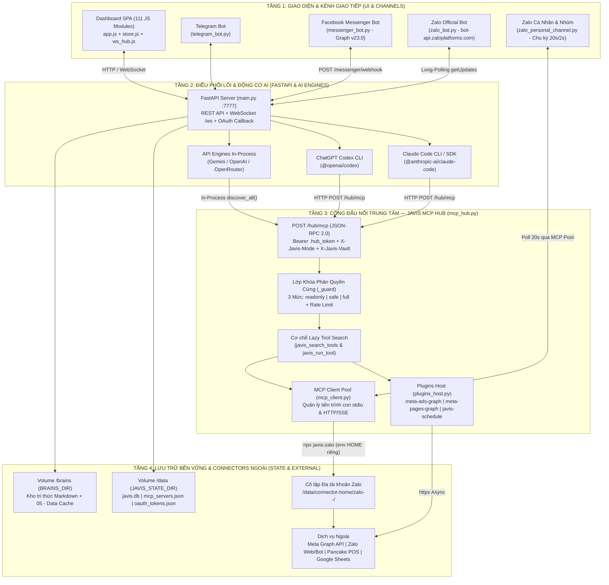
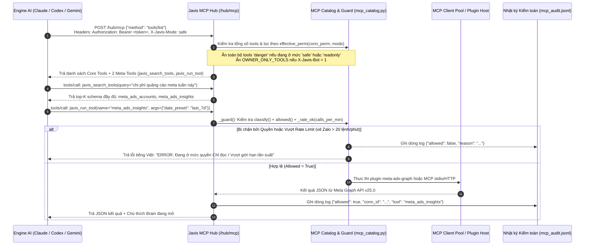
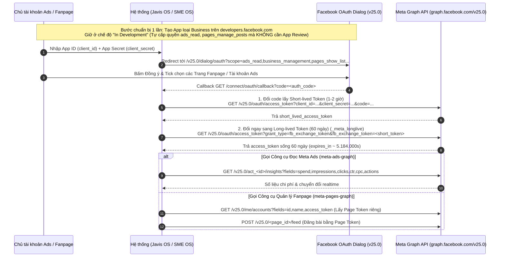
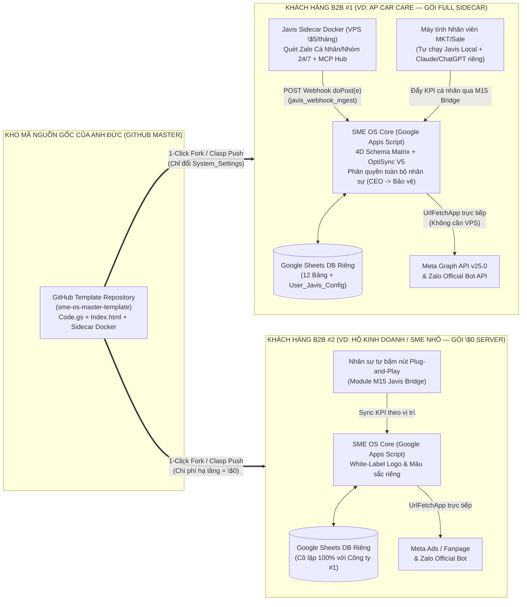

# 02 — BẢN ĐỒ KIẾN TRÚC & LUỒNG DỮ LIỆU (SCHEMATIC ARCHITECTURE)

> **Dự án:** SME OS / App AP CAR CARE  
> **Mã bằng chứng REA:** `ev_4028393e72aac241b12faf120c37d4052f9c30dac7435aea8fcb2e7977d57b9a`  
> **Thống kê AST REA (`dashboard/`):** 111 JS Files | 575.200 AST Nodes | 11.008 Call-Flow Relations | 40.029 Data-Flow Relations  
> **Mục đích:** Trực quan hóa toàn bộ cấu trúc nội tại của Javis OS và kiến trúc liên hợp với SME OS bằng hệ thống sơ đồ Mermaid chuẩn hóa.

---

## 1. Kiến trúc 4 Tầng Nội Tại của Javis OS (Internal 4-Layer Topology)

Sơ đồ dưới đây thể hiện chính xác cách Javis OS vận hành bên trong 1 container Docker hoặc máy chủ Local (cổng mặc định `7777`):



---

## 2. Luồng Thực Thi MCP Hub & Khóa Phân Quyền Cứng 3 Mức (`mcp_hub.py`)

Điểm sáng giá nhất của `server/mcp_hub.py` là **mọi Engine AI (Claude, Codex, Gemini) chỉ nhìn thấy đúng 1 MCP Server duy nhất tên là `javis`**. Khi có hơn 30 công cụ, Hub tự động bật chế độ **Lazy Loading** (chỉ nạp 2 meta-tools `javis_search_tools` và `javis_run_tool` để tiết kiệm 85% token ngữ cảnh):



---

## 3. Cơ Chế Cô Lập Đa Tài Khoản Zalo Cá Nhân & Tag `@Mention` Nhóm (`zalo_login.py` & `zalo_personal_channel.py`)

Công cụ gốc `zalo-agent-cli` (dựa trên thư viện `zca-js`) vốn chỉ lưu 1 phiên đăng nhập duy nhất tại `~/.zalo-agent-cli`, dẫn đến việc đăng nhập số Zalo thứ 2 sẽ ghi đè số thứ nhất. Javis OS đã giải quyết triệt để bài toán này bằng **Mẹo đánh lừa biến môi trường `HOME`** kết hợp **Bộ đếm vị trí UTF-16LE cho lệnh `@mention` trong nhóm**:

```mermaid
sequenceDiagram
    autonumber
    participant User as Nhân sự (Trình duyệt + App Zalo ĐT)
    participant Fast as Javis Server (zalo_login.py)
    participant CLI as Tiến trình npx javis-zalo
    participant FS as Thư mục Cô lập (STATE_DIR/connector-home/)
    participant Loop as Vòng lặp Quét ngầm (zalo_personal_channel.py)

    User->>Fast: Bấm "Kết nối Zalo QR" (POST /connect/zalo/start)
    Fast->>FS: Tạo thư mục riêng: /data/connector-home/zalo-<slug>-<sid>/
    Fast->>CLI: Spawn: npx javis-zalo login --json<br/>Ghi đè env: HOME = USERPROFILE = /data/connector-home/zalo-<slug>-<sid>
    CLI-->>Fast: Stdout JSON: {"event": "qr", "dataUrl": "data:image/png;base64,..."}
    Fast-->>User: Hiển thị ảnh mã QR trên Modal (Timeout 180s)
    User->>CLI: Mở Zalo trên điện thoại -> Quét mã QR & Bấm Xác nhận
    CLI->>FS: Lưu cookie & secret key zca-js vào $HOME/.zalo-agent-cli
    CLI-->>Fast: Stdout JSON: {"event": "login_success", "displayName": "Sale Minh", "ownId": "849..."}
    Fast->>Fast: Lưu cấu hình vào mcp_servers.json (HOME cố định theo tài khoản)

    loop Mỗi 20 giây (hoặc 2 giây khi có khách đang chat riêng trong 60s gần nhất)
        Loop->>CLI: Gọi trực tiếp qua mcp_client.pool: zalo_get_messages(limit=20)
        CLI-->>Loop: Danh sách tin nhắn mới (isGroup, threadId, senderName, content, mentions)
        alt Tin nhắn trong Nhóm (isGroup = true)
            Loop->>Loop: Kiểm tra: Có tag @Bot? Có reply Bot? Hoặc có thành viên mới vào nhóm?
            Loop->>Loop: Tính vị trí UTF-16 code units: len(prefix.encode("utf-16-le")) // 2
            Loop->>CLI: Gọi zalo-agent-cli msg send <threadId> -t group --mention "<offset>:<len>:<uid>"
        else Tin nhắn Riêng (isGroup = false)
            Loop->>CLI: Gọi zalo_send_message(thread_id, message)
        end
    end
```

---

## 4. Luồng Kết Nối Meta Ads & Fanpage Không Cần Duyệt App (`oauth_mcp.py` & `meta-ads-graph`)



---

## 5. Kiến Trúc Lai Liên Hiệp SME OS $\times$ Javis OS & Nhân Bản B2B Qua GitHub (Target Architecture)

Sơ đồ tổng thể mô hình triển khai cho hệ sinh thái B2B của anh Đức:


