# 06 — PHƯƠNG ÁN KIẾN TRÚC TÍCH HỢP MCP HUB (HARAVAN, GETFLY, JAVIS) & LUỒNG DỮ LIỆU ĐA PHÒNG BAN CHUẨN 5 FILE CỐT LÕI SME OS

> **Dự án:** SME OS / App AP CAR CARE  
> **Đối chiếu Chuẩn:** 5 Tài liệu Kiến trúc Cốt lõi SME OS ([`01-PRODUCT-PHILOSOPHY.md`](file:///D:/My%20Agents/Projects/App%20AP%20CAR%20CARE/hq/sme-os-core/01-PRODUCT-PHILOSOPHY.md) $\rightarrow$ [`05-TECHNOLOGY-ARCHITECTURE.md`](file:///D:/My%20Agents/Projects/App%20AP%20CAR%20CARE/hq/sme-os-core/05-TECHNOLOGY-ARCHITECTURE.md))  
> **Dành cho:** Product Owner (Anh Tăng Trí Đức) & Lead Architect (Lucy)  
> **Ngày lập:** 2026-10-24

---

## PHẦN 1: GIẢI ĐÁP HẠ TẦNG THẬT CỦA JAVIS OS & ĐIỀU CHỈNH CHIẾN LƯỢC

### 1.1. Javis OS đang dùng Google Apps Script (GAS) hay nền tảng nào? Dùng Backend Hosting nào?

Qua kiểm toán mã nguồn REA, câu trả lời chính xác 100% là:
1. **Javis OS HOÀN TOÀN KHÔNG dùng Google Apps Script (GAS).**
2. **Nền tảng Lõi (Tech Stack) của Javis OS:**
   - **Backend Server:** Viết bằng ngôn ngữ **Python 3.12**, chạy trên framework **`FastAPI` + `uvicorn`** (`server/main.py`, mở cổng mặc định `7777`).
   - **Runtime Phụ trợ:** Dùng **Node.js 22** để chạy các tiến trình con (`subprocess`) như gói quét Zalo QR (`npx javis-zalo`), Claude Code CLI (`@anthropic-ai/claude-code`) và ChatGPT Codex CLI (`@openai/codex`).
   - **Database nội bộ:** Dùng **SQLite** (`javis.db`, `memory.db` lưu trên ổ cứng máy chạy Javis) kết hợp với các file **JSON** (`mcp_servers.json`, `oauth_tokens.json`) và thư mục chứa các file văn bản **Markdown** (`brains/`).
   - **Frontend:** Là bộ file tĩnh **Vanilla JavaScript (111 file `.js` trong `dashboard/`) + HTML/CSS** được chính Python FastAPI trả về.
3. **Backend Hosting của Javis OS:**
   - Javis OS theo mô hình **100% Self-Hosted (Người dùng tự cài trên máy của mình)**, tác giả không nuôi server đám mây trung tâm:
     - **Cách 1 (Chạy trên PC/Laptop cá nhân):** Nhân sự cài Python + Node.js (hoặc bản đóng gói) lên máy Windows/Mac cá nhân, chạy ở `http://localhost:7777`. Khi tắt máy tính hoặc đóng cửa sổ lệnh thì Javis ngừng chạy.
     - **Cách 2 (Chạy trên VPS Linux bằng Docker 24/7):** Thuê 1 máy chủ ảo VPS Ubuntu/Debian (như Hostinger, Vultr, Hetzner, DigitalOcean giá khoảng \$4–\$6/tháng), cài Docker (`docker compose up -d`) và nối ra tên miền HTTPS bằng **Cloudflare Tunnel (`cloudflared`)**.

---

### 1.2. Tại sao Giai đoạn 2, 3, 4 đề xuất trước đó chưa hợp lý & Định vị lại theo 5 File Cốt lõi SME OS

Anh Đức đã chỉ ra rất đúng điểm bất hợp lý:
- **Sai lầm của lộ trình cũ:** Khi mỗi nhân sự đã dùng Javis OS như **1 Trợ lý cá nhân (Personal AI Collector)** để thu thập dữ liệu từ Zalo, Meta, Google, ghi chú... về rồi, việc bắt SME OS viết lại các trình cào Meta Ads hay bot Zalo riêng lẻ ở Giai đoạn 2, 3, 4 là **dẫm chân lên Javis OS**, làm phình code của SME OS và vi phạm **Điều 4, 5, 7 Hiến pháp SME OS** ([`05-TECHNOLOGY-ARCHITECTURE.md`](file:///D:/My%20Agents/Projects/App%20AP%20CAR%20CARE/hq/sme-os-core/05-TECHNOLOGY-ARCHITECTURE.md#L44-L110): *Không Over-engineering, luôn chọn cách đơn giản nhất*).
- **Định vị lại Ranh giới Chuẩn xác giữa Javis OS, Các MCP Doanh nghiệp (Haravan, Getfly) và SME OS:**
  1. **Javis OS = Trợ lý Cá nhân & Cổng Thu Thập Đầu Nguồn của Nhân sự (Personal Edge Collector):** Mỗi cá nhân (Sale, MKT, Quản đốc, CEO) dùng Javis để gom dữ liệu từ các tài khoản cá nhân của họ (Zalo cá nhân, nhóm Zalo, Facebook cá nhân, lịch cá nhân, phiên hỏi đáp Claude/ChatGPT) rồi đẩy kết quả đã lọc sạch về SME OS.
  2. **SME OS MCP Hub (`KERNEL_McpHub`) = Cổng Đấu Nối Trực Tiếp Các Nền Tảng Cấp Công Ty (Haravan, Getfly CRM, KiotViet, Sapo...):** Học đúng kiến trúc **MCP Hub (`mcp_hub.py`)** của Javis nhưng viết gọn bằng chuẩn **Google Apps Script (`Code.gs`) ở Phase 1** để kết nối trực tiếp với các phần mềm vận hành phổ biến nhất của SME Việt Nam như **Haravan** (Bán hàng đa kênh, Sản phẩm, Đơn hàng, Tồn kho) và **Getfly CRM** (Quản lý Lead, Cơ hội bán hàng, KPI Chăm sóc khách).
  3. **SME OS Core = Trái Tim Lưu Trữ Duy Nhất (`SSOT Master Database`), Điều Phối Sự Kiện (`Event Center`) & Hiển Thị Đa Phòng Ban (`7-Layered Architecture`):** Mọi dữ liệu dù đến từ **Javis của nhân viên** hay từ **MCP Haravan / Getfly của công ty** đều phải đi qua một đường ống chuẩn hóa duy nhất, lưu vào đúng **10 Bảng Đối tượng Kinh doanh Cốt lõi** (File 2 & File 4) và phân phối về đúng **Dashboard của từng Phòng Ban** theo phân quyền 4 chiều (`4D FIELD_MAP`).

---

## PHẦN 2: KIẾN TRÚC `KERNEL_McpHub` TRONG SME OS & KẾT NỐI THỰC TẾ VỚI HARAVAN, GETFLY, JAVIS

### 2.1. Học Gì Từ `mcp_hub.py` Của Javis Để Đưa Vào `KERNEL_McpHub` Của SME OS?

Từ 2.290 dòng code của [`server/mcp_hub.py`](file:///C:/Users/TANG%20KIM%20SON/.gemini/antigravity/brain/91625aa6-de56-4655-a1fe-4d426b1964c6/scratch/javis-os/server/mcp_hub.py), chúng ta chắt lọc **4 Cơ chế Vàng** đưa vào tầng **Platform Layer (Lớp 6 — `KERNEL_McpHub` trong `Code.gs`)** của SME OS:

1. **Sổ đăng ký Kết nối Tập trung (`MCP_CONNECTOR_CATALOG` — Configuration over Customization):**
   - Khai báo mọi dịch vụ (Haravan, Getfly, Javis Personal Bridge, Pancake, KiotViet...) dưới dạng **JSON Manifest chuẩn** (gồm `connector_id`, `base_url`, `auth_type`, `rate_limit_per_min`, `tools_schema`, `entity_mapping`). Thêm nền tảng mới chỉ cần khai báo thêm 1 khối cấu hình trong Catalog, không phải sửa logic lõi.
2. **Một Cổng Gọi Hàm Duy Nhất (`KERNEL_McpHub.dispatchTool(actor, connectorId, toolName, args)`):**
   - Mọi phân hệ hoặc giao diện khi cần lấy/đẩy dữ liệu sang Haravan, Getfly hay Javis đều gọi qua đúng 1 hàm `dispatchTool` duy nhất (giống hệt `/hub/mcp` của Javis).
3. **Khóa Phân Quyền Cứng 3 Mức Kết Hợp Ma Trận 4D (`readonly` / `safe` / `full` + `4D RBAC`):**
   - Mỗi kết nối MCP trong SME OS có mức quyền cứng:
     - `readonly` (Mặc định khi mới đấu nối Test): Chỉ cho phép gọi các tool `read` (đọc đơn hàng Haravan, đọc danh sách khách Getfly). Mọi lệnh tạo/sửa/xóa bị chặn cứng tại Kernel.
     - `safe` (Ghi nháp): Cho phép đẩy bản nháp hoặc tạo Task/Note, nhưng chặn các thao tác nhạy cảm (duyệt hóa đơn, trừ tiền, xóa dữ liệu).
     - `full` (Toàn quyền — yêu cầu quyền `PO` / `CEO` hoặc qua `Approval Node`): Cho phép đồng bộ 2 chiều thực thi thật.
4. **Bộ Kiểm Tra Sức Khỏe Kết Nối Thực Tế (`validateConnection` & Chẩn Đoán Lỗi Tiếng Việt):**
   - Giống hàm `validate_connection()` và `chan_doan_loi()` của Javis: Khi người dùng dán API Key của Haravan hoặc Getfly vào và bấm **[Kiểm tra Kết nối (Test)]**, `KERNEL_McpHub` gọi thử 1 lệnh nhẹ nhất (`shop.json` của Haravan hoặc `/api/v3/account` của Getfly), đếm số công cụ khả dụng, tự động lấy **Tên Shop / Tên Công ty thật** và trả về thông báo chẩn đoán lỗi bằng **100% Tiếng Việt dễ hiểu** nếu sai Key hoặc thiếu quyền.

---

### 2.2. Thiết Kế Chi Tiết 2 MCP Connector Phổ Biến Nhất Cho SME Để Test Thực Tế: HARAVAN & GETFLY CRM

#### A. Connector #1: `haravan-mcp` (Bán hàng Đa kênh, Sản phẩm, Đơn hàng, Tồn kho)
- **Phương thức Xác thực (Authentication):**
  - Sử dụng **Haravan Private App Bearer Token** (hoặc OAuth2 Access Token) tạo trực tiếp trong trang quản trị Haravan (*Cấu hình $\rightarrow$ Ứng dụng riêng $\rightarrow$ Tạo ứng dụng riêng*).
  - Header chuẩn: `Authorization: Bearer <haravan_access_token>`, `Content-Type: application/json`.
  - Base URL: `https://apis.haravan.com/com`
- **Danh mục MCP Tools chuẩn hóa trong SME OS (`haravan-mcp`):**

| Tên MCP Tool (`toolName`) | Phân loại Quyền | Endpoint Haravan Thật | Ánh xạ vào Bảng Cốt lõi SME OS (`Master Database`) |
| :--- | :---: | :--- | :--- |
| **`haravan_verify_shop`** *(Hàm Test Kết nối)* | `read` | `GET /shop.json` | Kiểm tra Token sống/chết, lấy tên Shop, email, tiền tệ, domain. |
| **`haravan_sync_products`** | `read` | `GET /products.json?limit=50` | Chuẩn hóa SKU, tên SP, giá bán lẻ, tồn kho $\rightarrow$ Bảng **`products`** (`PRD_`). |
| **`haravan_sync_orders`** | `read` | `GET /orders.json?status=any&limit=50` | Chuẩn hóa đơn hàng, trạng thái thanh toán $\rightarrow$ Bảng **`invoices`** (`INV_`) & **`bookings`** (`BKG_`). |
| **`haravan_sync_customers`** | `read` | `GET /customers.json?limit=50` | Chuẩn hóa SĐT, họ tên, tổng chi tiêu $\rightarrow$ Bảng **`customers`** (`CUS_`). |
| **`haravan_update_inventory`** | `write` (`safe`) | `POST /inventories/adjustorset.json` | Đồng bộ ngược số lượng tồn kho từ xưởng SME OS lên Haravan. |
| **`haravan_create_order`** | `danger` (`full`) | `POST /orders.json` | Tạo đơn hàng mới trên Haravan (bắt buộc qua `Approval Node` nếu vượt hạn mức). |

- **Cổng Nhận Webhook Thời Gian Thực (`doPost`):**
  - Haravan bắn Webhook (`orders/create`, `orders/paid`, `products/update`) kèm chữ ký `X-Haravan-Hmacsha256` về URL Web App của SME OS $\rightarrow$ `KERNEL_Gateway` xác thực chữ ký $\rightarrow$ phát sự kiện `HARAVAN_ORDER_CREATED` vào bảng `sys_events`.

#### B. Connector #2: `getfly-mcp` (Quản lý Khách hàng CRM, Phễu Sale, Công việc & KPI)
- **Phương thức Xác thực (Authentication):**
  - Sử dụng **Getfly API Key** và **Base Domain riêng của doanh nghiệp** (lấy tại *Getfly Admin $\rightarrow$ Cài đặt $\rightarrow$ Tích hợp $\rightarrow$ API*).
  - Header chuẩn: `X-API-KEY: <getfly_api_key>`, `Accept: application/json`.
  - Base URL: `https://<ten_cong_ty>.getflycrm.com/api/v3`
- **Danh mục MCP Tools chuẩn hóa trong SME OS (`getfly-mcp`):**

| Tên MCP Tool (`toolName`) | Phân loại Quyền | Endpoint Getfly Thật | Ánh xạ vào Bảng Cốt lõi SME OS (`Master Database`) |
| :--- | :---: | :--- | :--- |
| **`getfly_verify_connection`** *(Hàm Test Kết nối)* | `read` | `GET /account/sources` (hoặc `/users`) | Kiểm tra `X-API-KEY` và tên miền Getfly hợp lệ, đếm số nhân viên/nguồn khách. |
| **`getfly_sync_leads`** | `read` | `GET /accounts?limit=50` | Đồng bộ danh sách Khách hàng/Lead, nguồn khách, người phụ trách $\rightarrow$ Bảng **`customers`** (`CUS_`). |
| **`getfly_sync_orders_deals`** | `read` | `GET /orders?limit=50` | Đồng bộ cơ hội bán hàng / đơn hàng CRM $\rightarrow$ Bảng **`bookings`** (`BKG_`) / **`invoices`** (`INV_`). |
| **`getfly_sync_tasks`** | `read` | `GET /tasks` (hoặc `/activities`) | Đồng bộ lịch hẹn gọi điện / chăm sóc khách của Sale $\rightarrow$ Bảng **`tasks`** (`TSK_`). |
| **`getfly_create_lead`** | `write` (`safe`) | `POST /account` | Đẩy khách đặt lịch mới từ Website/Xưởng SME OS sang phễu chăm sóc của Getfly. |

---

### 2.3. Sơ Đồ Luồng Tích Hợp Toàn Trình Từ Backend Đến Frontend (End-to-End Flow)

```mermaid
flowchart TB
    subgraph EXT["1. TẦNG NGUỒN DỮ LIỆU ĐA NỀN TẢNG (EXTERNAL & PERSONAL SOURCES)"]
        JV["Trợ lý Cá nhân Javis OS của Nhân sự\n(Zalo QR, Meta Ads, Fanpage, Ghi chú AI)\nĐẩy theo Nhu cầu từng Vị trí"]
        HRV["Haravan Omnichannel MCP\n(REST API apis.haravan.com + Webhook)\nSản phẩm, Đơn hàng, Tồn kho, Khách hàng"]
        GFY["Getfly CRM MCP\n(REST API *.getflycrm.com/api/v3 + Webhook)\nLead, Cơ hội bán hàng, Lịch chăm sóc, KPI Sale"]
    end

    subgraph KERNEL["2. TẦNG PLATFORM & KERNEL SME OS (LỚP 6 — CODE.GS)"]
        GW["KERNEL_Gateway & KERNEL_McpHub\n• Xác thực Token / HMAC / X-API-KEY\n• Khóa quyền cứng 3 mức: readonly | safe | full\n• Chống trùng lặp (Idempotency Key + SĐT 10 số)"]
        NORM["Bộ Chuẩn Hóa Dữ Liệu (Canonical Data Normalizer)\nBiến JSON thô của Javis/Haravan/Getfly thành\n5 Khuôn mẫu Chuẩn (Canonical Payloads)"]
        EVC["❤️ EVENT CENTER (Bảng sys_events)\nPhát sự kiện: LEAD_SYNCED | ORDER_PAID | STOCK_UPDATED |\nCAMPAIGN_REPORTED | TASK_PROPOSED"]
        APPR["Chốt Phê Duyệt (Approval Node — Human-in-the-Loop)\nGiữ lại các lệnh Nhạy cảm (Tài chính/Giá/Xóa) ở trạng thái DRAFT"]
    end

    subgraph DB["3. TẦNG LƯU TRỮ DUY NHẤT — MASTER DATABASE (LỚP 7 — SSOT 10 BẢNG CỐT LÕI)"]
        direction LR
        T_CUS[("1. customers\n(CUS_)")]
        T_BKG[("7. bookings\n(BKG_)")]
        T_INV[("6. invoices\n(INV_)")]
        T_PRD[("3. products\n(PRD_)")]
        T_CMP[("8. campaigns\n(CMP_)")]
        T_TSK[("9. tasks\n(TSK_)")]
    end

    subgraph FE["4. TẦNG TRẢI NGHIỆM ĐA PHÒNG BAN (LỚP 2 — INDEX.HTML + OPTISYNC V5 + 4D FIELD_MAP)"]
        STORE["Central AppStore (OptiSync V5)\nSingle-Read Snapshot + Ghost RAM 15s + 4D Role Filter"]
        D_CEO["Dashboard CEO / Founder\n5 Business Goals + Duyệt Approval Node"]
        D_MKT["Phòng Marketing\nROAS Thật (Meta Javis + Đơn Haravan)"]
        D_SALE["Phòng Sales & CSKH\nHồ sơ Khách 360 (Gộp Zalo + Getfly + Haravan)"]
        D_TECH["Phòng Kỹ thuật / Xưởng\nKhoang xe, Lệnh sửa chữa (Ẩn giá vốn/doanh thu)"]
        D_FIN["Phòng Kế toán & Kho\nĐối soát Hóa đơn Haravan & Cảnh báo Tồn kho"]
        D_OPS["Bảo vệ / Lao công / Thời vụ\nBáo biển số xe sắp đến & Checklist 1 chạm (<30s)"]
    end

    JV -->|"POST / api_javis_push_output"| GW
    HRV <-->|"haravan_* tools & Webhook"| GW
    GFY <-->|"getfly_* tools & Webhook"| GW

    GW --> NORM
    NORM --> EVC
    EVC --> APPR
    EVC -->|"Upsert qua 4D FIELD_MAP"| T_CUS & T_BKG & T_INV & T_PRD & T_CMP & T_TSK
    APPR -.->|"Khi CEO/TrưởngBP bấm Duyệt"| T_INV & T_PRD

    T_CUS & T_BKG & T_INV & T_PRD & T_CMP & T_TSK --> STORE
    STORE --> D_CEO & D_MKT & D_SALE & D_TECH & D_FIN & D_OPS
```



---

## PHẦN 3: PHƯƠNG ÁN THU THẬP, CHUẨN HÓA & LƯU TRỮ DỮ LIỆU TỪ JAVIS + MCP VỀ BACKEND SME OS (KHOA HỌC, GỌN GÀNG, CHUẨN 5 FILE CỐT LÕI)

Để dữ liệu từ Javis (của hàng chục nhân sự) và từ Haravan/Getfly đổ về SME OS **không biến thành một bãi rác dữ liệu trùng lặp**, chúng ta áp dụng **Quy trình Tinh lọc 3 Bước (3-Stage Data Hygiene Pipeline)** bám sát tuyệt đối **File 1 (`SSOT`), File 3 (`Event-Driven`), File 4 (`10 Core Tables + 4D FIELD_MAP`) và File 5 (`Single-Read Snapshot`)**:

### Bước 1: Quy ước "Phễu Đầu Vào 5 Khuôn Mẫu" (5 Canonical Envelopes) — Cấm Đẩy Dữ Liệu Tự Do
Khi Javis OS của bất kỳ nhân sự nào (hoặc MCP Haravan/Getfly) gửi dữ liệu về SME OS, bộ chuyển đổi **`Normalizer`** tại Backend chỉ chấp nhận và tự động phân loại vào đúng **5 Khuôn mẫu Chuẩn (Canonical Payloads)** tương ứng với các thực thể kinh doanh của SME OS:

| STT | Mã Sự Kiện Chuẩn (`event_name` trên `sys_events`) | Nguồn Thu Thập (Từ Javis của Nhân sự hoặc MCP Công ty) | Khóa Chống Trùng Lặp (`Deduplication Key`) | Bảng Đích Duy Nhất (`Master Database` — File 4) |
| :---: | :--- | :--- | :--- | :--- |
| **1** | **`CUSTOMER_UPSERTED`** | • Javis của Sale (tóm tắt khách chat Zalo/FB)<br/>• Getfly MCP (`getfly_sync_leads`)<br/>• Haravan MCP (`haravan_sync_customers`) | **`phone` chuẩn hóa 10 số** (VD: `+84909123456` $\rightarrow$ `0909123456`). Nếu đã có SĐT $\rightarrow$ **Cập nhật bổ sung (`Merge`)**, tuyệt đối không tạo dòng khách thứ 2! | Bảng #1: **`customers`** (`CUS_`) |
| **2** | **`BOOKING_UPSERTED`** | • Javis của Cố vấn/Sale (lịch hẹn khách chốt qua Zalo)<br/>• Getfly MCP (`getfly_sync_orders_deals`)<br/>• Website Booking Sensor | **`license_plate` (Biển số xe) + `scheduled_date`** hoặc `external_order_id`. | Bảng #7: **`bookings`** (`BKG_`) |
| **3** | **`INVOICE_SYNCED`** | • Haravan MCP (`haravan_sync_orders`)<br/>• Javis của Kế toán (bóc tách UNC/hóa đơn) | **`external_invoice_id`** (Mã đơn Haravan `#10025`). Mặc định từ Javis vào sẽ mang trạng thái `DRAFT` chờ Kế toán duyệt (`Approval Node`). | Bảng #6: **`invoices`** (`INV_`) |
| **4** | **`STOCK_OR_PRODUCT_SYNCED`** | • Haravan MCP (`haravan_sync_products`)<br/>• Javis của Thủ kho (kiểm kê nhanh) | **`sku`** (Mã sản phẩm/vật tư chuẩn hóa viết hoa). | Bảng #3: **`products`** (`PRD_`) |
| **5** | **`CAMPAIGN_OR_TASK_LOGGED`** | • Javis của MKT (báo cáo chi phí Meta/TikTok/Google Ads)<br/>• Getfly MCP (`getfly_sync_tasks`)<br/>• Javis của bất kỳ nhân viên nào giao/nhận việc | **`campaign_id` + `date`** (cho bảng `campaigns`) hoặc **`external_task_id`** (cho bảng `tasks`). | Bảng #8: **`campaigns`** (`CMP_`)<br/>Bảng #9: **`tasks`** (`TSK_`) |

### Bước 2: Lưu Trữ Vật Lý Ở Backend Ra Sao Để Gọn Gàng & Tốc Độ Cao Nhất?
1. **Không Đẻ Thêm Bảng Rác (Strict SSOT — File 1 & File 4):**
   - Toàn bộ dữ liệu nghiệp vụ sau khi qua `sys_events` đều nằm gọn trong **10 Bảng Đối tượng Kinh doanh Cốt lõi** đã thiết kế ở Chương 2 File 4 (`customers`, `employees`, `products`, `services`, `suppliers`, `invoices`, `bookings`, `campaigns`, `tasks`, `assets`).
   - **Làm sao biết dòng dữ liệu đó do Javis của ai hay do Haravan/Getfly đẩy vào?** Chúng ta không tạo thêm cột thừa làm phình bảng, mà ghi chuẩn xác vào cột **`audit_trail` (JSON Array — Cột hệ thống số 6 bắt buộc của mọi bảng trong File 4)**:
     ```json
     [
       {
         "ts": "2026-10-24 17:45:00",
         "actor": "EMP_SALE_02 (via Javis Zalo)",
         "source": "JAVIS_PERSONAL",
         "confidence": 92,
         "diff": "Cập nhật dòng xe: Porsche Macan, Nhu cầu: Dán PPF gói फुल"
       }
     ]
     ```
2. **Cơ Chế Xoay Vòng Tự Động Cho Bảng Sự Kiện & Nhật Ký (`Rolling 3,000-Row Limit` — File 5):**
   - Bảng `sys_events`, `sys_audit_logs` và `Javis_Sync_Logs` áp dụng cơ chế **Cuốn chiếu 3.000 dòng**: Bản ghi mới luôn chèn ở Dòng 12 (`MIN_DATA_ROW = 12`), phần vượt quá dòng 3.012 tự động được cắt bỏ hoặc nén lưu trữ sang file JSON tháng trên Google Drive. Nhờ vậy Google Sheets của doanh nghiệp chạy 5 năm vẫn nhẹ dưới `1.5 giây`!
3. **Đọc 1 Lần Duy Nhất Vào RAM (`Single-Read Snapshot` — File 5):**
   - Khi một gói đồng bộ từ Haravan (50 đơn hàng) hoặc từ Javis gửi lên, `KERNEL_McpHub` chỉ gọi `getDataRange().getValues()` đúng **1 lần duy nhất** vào RAM, đối chiếu trùng lặp SĐT/SKU trong bộ nhớ (mất `0.005 giây`), rồi ghi hàng loạt (`setValues`) trong 1 lệnh duy nhất, bọc trong `LockService.getScriptLock()` để không bao giờ xung đột khi 10 nhân viên cùng bấm đồng bộ một lúc.

---

## PHẦN 4: TRÌNH BÀY FRONTEND THEO CÁC PHÒNG BAN NHƯ THẾ NÀO ĐỂ PHÙ HỢP VỚI 5 BỘ NGUYÊN TẮC CỐT LÕI CỦA SME OS?

Theo **File 1 (`Product Philosophy`)**, **File 2 (`Business Architecture`)** và **File 4 (`UI Architecture`)**, giao diện Frontend của SME OS phải tuân thủ nghiêm ngặt 4 nguyên tắc vàng:
- **`AI Everywhere, not AI Chat`:** Không bắt nhân viên vào một khung chat trắng để hỏi AI. Dữ liệu từ Javis, Haravan, Getfly phải biến thành **Số liệu sống, Cảnh báo màu sắc và Nút bấm 1 chạm** đặt sẵn ngay tại màn hình làm việc của từng phòng ban.
- **`Simplicity First (Rule of 30 Seconds)` & `100% Tiếng Việt Thuần Túy`:** Nhân sự mở màn hình của phòng mình ra trong **30 giây phải hiểu ngay hôm nay cần làm gì**. Ẩn toàn bộ từ khóa kỹ thuật (`MCP`, `JSON`, `Payload`, `Webhook` được dịch thành *"Đồng bộ tự động"*, *"Trợ lý Javis gợi ý"*, *"Nguồn: Haravan / Getfly"*).
- **`AI Never Guess (Confidence Score)` & `Human-in-the-Loop (Approval Node)`:** Mọi đề xuất do Javis AI đẩy về đều hiển thị **Độ tin cậy (`% Confidence`)**: $\ge 95\%$ hiện Cảnh báo Đỏ; $80\%–94\%$ hiện Thẻ Đề xuất kèm nút **[Duyệt 1 chạm]**; $< 60\%$ tự động ẩn để không làm phiền nhân sự.
- **`4D FIELD_MAP Role Filtering`:** Ai thuộc phòng ban nào chỉ nhìn thấy đúng bảng, đúng cột và đúng dòng của phòng ban đó.

### Bảng Thiết Kế Giao Diện Frontend Chi Tiết Cho 7 Phòng Ban / Vị Trí:

| Phòng Ban / Vị Trí (`Role`) | Dữ Liệu Nhận Về (Từ Javis Cá Nhân + Haravan + Getfly) | Cách Trình Bày Trên Giao Diện Frontend (`Index.html`) Chuẩn 5 File SME OS | Quyền Hạn 4D & Chốt Duyệt (`Approval Node`) |
| :--- | :--- | :--- | :--- |
| **1. Ban Giám Đốc (CEO / Founder / PO)** | • Tổng hợp Doanh thu (`invoices` từ Haravan + Xưởng)<br/>• Chi phí Ads (`campaigns` từ Javis MKT)<br/>• Tỷ lệ chuyển đổi Lead (`customers` từ Getfly)<br/>• Các cảnh báo bất thường do Javis phát hiện | **Màn hình "Bàn Làm Việc Điều Hành (Executive Cockpit)":**<br/>1. **5 Thẻ Sức Khỏe Doanh Nghiệp (5 Business Goals File 2):** Doanh thu (*Revenue*), Lợi nhuận ước tính (*Profit*), Năng suất xưởng (*Productivity*), Điểm hài lòng khách (*CX*), Hiệu suất nhân sự (*EX*).<br/>2. **Khối "Chờ Anh Duyệt (Approval Nodes)":** Danh sách các đề xuất từ Javis / Các phòng ban kèm `% Độ tin cậy` và 2 nút **[✓ Phê duyệt]** / **[✕ Từ chối]**. | **Toàn quyền (`RW` toàn bộ 10 bảng).**<br/>Người duy nhất mở khóa được các dòng đã `COMPLETED` / `PAID`. |
| **2. Phòng Marketing (`MKT`)** | • Số liệu chi tiêu, CPC, CTR, Reach từ Javis (Meta/TikTok/Google Ads)<br/>• Số lượng Lead thực tế đổ về từ Getfly<br/>• Doanh thu thực thu từ Haravan / Xưởng | **Màn hình "Trung Tâm Chiến Dịch & Hiệu Quả Quảng Cáo":**<br/>1. **Bảng Đối Soát ROAS Thật (3 Nguồn Hợp Nhất):** Cột 1: Tiền tiêu Ads (từ Javis) $\rightarrow$ Cột 2: Số SĐT thu được (từ Getfly/Zalo) $\rightarrow$ Cột 3: Tiền thu thật tại Xưởng/Haravan (`invoices`).<br/>2. **Huy hiệu Cảnh báo AI:** Nếu 1 chiến dịch tiêu $> 2$ triệu mà 0 Lead (`Confidence 95%`), hiện nhãn đỏ *"⚠️ Đề xuất tạm dừng"*. | Xem/Sửa bảng `campaigns`, tạo `customers` (Lead mới).<br/>**Ẩn:** Giá vốn sản phẩm (`cost_price`), bảng lương nhân sự. |
| **3. Phòng Kinh Doanh / Sales & CSKH (`SALE` / `RECEPTION`)** | • Tin nhắn & tóm tắt nhu cầu khách từ Javis Zalo cá nhân của chính Sale đó<br/>• Hồ sơ khách & lịch hẹn gọi từ Getfly CRM<br/>• Lịch sử mua hàng trên Haravan | **Màn hình "Phễu Khách Hàng 360° & Lịch Chăm Sóc Hôm Nay":**<br/>1. **Thẻ Khách Hàng Hợp Nhất (Zero Duplicate):** Tự động gộp thông tin từ Zalo (Javis) + Getfly + Haravan theo SĐT. Hiển thị dòng xe, biển số, tổng chi tiêu và câu tóm tắt ngắn gọn do Javis đúc kết (*"Khách hỏi dán PPF xe CX5, hẹn thứ Bảy"*).<br/>2. **Nút Bấm 1 Chạm:** **[+ Tạo Lịch Hẹn Xưởng]** (đẩy sang `bookings`) hoặc **[✓ Đã gọi chăm sóc]**. | Xem/Sửa `customers` (do mình phụ trách), tạo `bookings`, `tasks`.<br/>**Ẩn cứng:** Giá vốn (`cost_price`) trong bảng `products`. |
| **4. Phòng Kỹ Thuật & Quản Đốc Xưởng (`MANAGER` / `TECH`)** | • Lịch xe hẹn đến trong ngày (`bookings`)<br/>• Ghi chú kỹ thuật đặc biệt do Javis bóc tách từ yêu cầu của khách<br/>• Định mức vật tư (`services`) | **Màn hình "Điều Phối Khoang Xe (Bay Slot) & Lệnh Thi Công":**<br/>1. **Sơ đồ Khoang Dịch Vụ Trực Quan:** Xe nào đang ở Khoang Rửa, Khoang Ceramic, Khoang Âm thanh Focal.<br/>2. **Thẻ Lệnh Sửa Chữa Tối Giản (30s hiểu ngay):** Biển số xe + Hạng mục làm + Lưu ý đặc biệt từ khách + Nút chụp ảnh **Trước / Sau thi công** (tự nén `<300KB` lên Drive) + Nút chuyển trạng thái `Đang làm` $\rightarrow$ `Chờ QC`. | Xem/Cập nhật tiến độ & ảnh trên `bookings`, `tasks`.<br/>**Ẩn 100% (`NONE`):** Số điện thoại khách hàng (chống cướp khách), đơn giá tiền, doanh thu, giá vốn! |
| **5. Phòng Kho & Mua Hàng (`INVENTORY`)** | • Biến động tồn kho & sản phẩm từ Haravan (`haravan_sync_products`)<br/>• Vật tư tiêu hao thực tế từ lệnh xưởng (`bookings`)<br/>• Cảnh báo hàng sắp hết từ Javis | **Màn hình "Kiểm Soát Tồn Kho & Định Mức Vật Tư":**<br/>1. **Danh sách Cảnh báo Đỏ (`stock_qty <= min_stock_threshold`):** Những mã phim PPF, dung dịch Detailing, loa Focal chạm đáy tồn kho kèm nút **[Tạo Đề Xuất Nhập Hàng]**.<br/>2. **Trạng thái Đồng bộ Haravan:** Hiển thị số lượng tồn tại Xưởng vs tồn trên Haravan để bấm **[Đồng bộ Tồn kho]** 1 chạm. | Xem/Sửa `products`, `suppliers`, `assets`. |
| **6. Phòng Kế Toán & Thu Ngân (`FINANCE` / `ADMIN`)** | • Đơn hàng đã thanh toán từ Haravan (`haravan_sync_orders`)<br/>• Lệnh xưởng đã nghiệm thu (`bookings.status = COMPLETED`)<br/>• Sao kê/Chứng từ do Javis Kế toán bóc tách | **Màn hình "Đối Soát Chứng Từ & Dòng Tiền (`invoices`)":**<br/>1. **Hàng đợi Hóa đơn Nháp (`DRAFT`):** Các đơn từ Haravan hoặc Javis đẩy về nằm gọn trong tab *"Chờ Kế toán xác nhận"*. Kế toán kiểm tra tiền về tài khoản rồi bấm **[Xác nhận Đã Thu (`PAID`)]**.<br/>2. Ngay khi bấm `PAID`, hệ thống kích hoạt **Khóa 4D (`LOCKED`)** đóng băng toàn bộ dòng hóa đơn đó. | Xem/Sửa `invoices`, xem `cost_price` (`products`), công nợ `suppliers`. |
| **7. Bộ Phận Bảo Vệ, Lao Công, Nhân Sự Thời Vụ (`STAFF_BASIC`)** | • Biển số xe khách sắp đến trong 30 phút tới (từ `bookings`)<br/>• Danh sách việc cần làm trong ca trực (từ Javis / Quản đốc giao vào `tasks`) | **Màn hình "Việc Cần Làm Trong Ca (Siêu Tối Giản — Học Trong 10 Giây)":**<br/>1. **Dành cho Bảo vệ tại Cổng:** Chỉ hiện danh sách chữ to: **"09:30 — Xe Mercedes Đen `51K-888.99` (Anh Nam) hẹn Phủ Ceramic"** kèm đúng 1 nút bấm lớn màu xanh: **[🚗 XE ĐÃ VÀO CỔNG]** (bấm xong tự phát sự kiện báo Lễ tân & Kỹ thuật ra đón!).<br/>2. **Dành cho Lao công / Thời vụ:** 3–5 ô tích chọn công việc trong ca + Chấm công 1 chạm. | **Chỉ thấy đúng 3 thông tin:** Giờ hẹn, Biển số xe/Loại xe, và Checklist việc của chính mình. Không thấy bất kỳ số liệu kinh doanh nào của công ty. |

---

## PHẦN 5: LỘ TRÌNH THỰC THI MỚI (CHUẨN HÓA, GỌN GÀNG, ĐÚNG TRỌNG TÂM)

Thay cho lộ trình cũ, em đề xuất **Lộ trình 3 Bước Thực Thi Ngay Trong SME OS (`App AP CAR CARE`)**:

1. **Bước 1 (Backend — Xây dựng `KERNEL_McpHub` & Đường Ống Chuẩn Hóa 5 Khuôn Mẫu trong `Code.gs`):**
   - Nâng cấp cổng tiếp nhận của SME OS thành **`KERNEL_McpHub`** tích hợp sẵn:
     - **Bộ Chuẩn Hóa 5 Thực Thể (`Canonical Normalizer`)** tự động phân bổ dữ liệu từ **Javis OS của nhân viên** vào thẳng 10 bảng cốt lõi (`customers`, `bookings`, `invoices`, `products`, `campaigns`, `tasks`) qua `sys_events` kèm khóa chống trùng lặp SĐT/SKU và ghi vết `audit_trail`.
     - **2 Adapter MCP Doanh nghiệp để Test thực tế:** **`haravan-mcp`** (`apis.haravan.com`) và **`getfly-mcp`** (`*.getflycrm.com/api/v3`) kèm hàm `validateConnection` kiểm tra kết nối sống và khóa quyền 3 mức (`readonly` / `safe` / `full`).
2. **Bước 2 (Frontend — Bổ sung Trạm Kiểm Thử Kết Nối Haravan & Getfly + Chế độ Xem Theo 7 Phòng Ban trên `Index.html`):**
   - Trên giao diện **⚡ Trung Tâm Kết Nối MCP & Javis AI**, bổ sung 2 thẻ đấu nối **Haravan Omnichannel** và **Getfly CRM** (có nút **[Kiểm tra Kết nối]** và nút **[Đồng bộ Thử Nghiệm]** để anh Đức test thực tế ngay với API Key thật hoặc chế độ Sandbox mẫu).
   - Bổ sung thanh chuyển đổi nhanh **"Góc Nhìn Phòng Ban (Departmental View Switcher: CEO | Marketing | Sales | Kỹ thuật Xưởng | Kho & Kế toán | Bảo vệ/Vận hành)"** để anh Đức nghiệm thu trực quan cách cùng một nguồn dữ liệu từ Javis + Haravan + Getfly được lọc và trình bày khác nhau như thế nào cho từng phòng ban!
3. **Bước 3 (Kiểm thử Thực tế & Đóng gói Chuẩn Master Template):**
   - Test toàn trình từ lúc bấm nút kéo dữ liệu Haravan / Getfly / Javis $\rightarrow$ qua `sys_events` $\rightarrow$ vào `Master Database` $\rightarrow$ hiển thị tức thì trên 7 góc nhìn phòng ban qua `OptiSync V5`.
