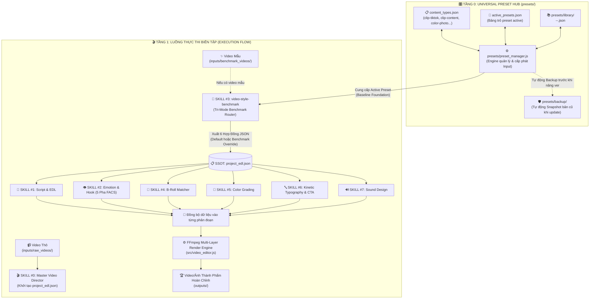

# 🗺️ BẢN ĐỒ KIẾN TRÚC TỔNG THỂ: HỆ SINH THÁI 8 SKILL & PRESET HUB (`schematic_map.md`)

> 📌 **Single Source of Truth (SSOT Architecture Map - v3.0 Universal Preset Hub):**
> File này là bản đồ kiến trúc trung tâm kết nối giữa:
> 1. **Universal Preset & Blueprint Hub (`presets/`)**: Hệ thống lưu trữ thông số mặc định độc lập, có versioning, auto-backup, phân loại theo Content Type (`<loại content> + <stt> + <ddmmyy>`) phục vụ cho cả Video, Ảnh, Meme, Infographic...
> 2. **Hệ sinh thái 8 Skill Dựng Phim**: Điều phối linh hoạt qua file SSOT [`project_edl.json`](file:///D:/My%20Agents/Tools/ai-video-editor/project_edl.json).

---

## 🎛️ I. PRESET HUB: BỘ CUNG CẤP INPUT ĐẦU VÀO ĐỘC LẬP (`presets/`)

Bộ thông số mặc định không nằm rải rác hay hardcode trong code JS, mà được tổ chức thành một **Module Quản Trị Preset Độc Lập** tại thư mục [`presets/`](file:///D:/My%20Agents/Tools/ai-video-editor/presets/):

```
presets/
├── content_types.json           # 📋 Danh mục loại content (thêm/sửa/xóa tự do)
├── active_presets.json          # 📌 Bảng trỏ preset active hiện hành (SSOT Pointer)
├── preset_manager.js            # ⚙️ Engine quản lý: nạp, chuyển đổi, auto-backup & nâng version
├── cli.js                       # 💻 Giao diện dòng lệnh tra cứu & thao tác nhanh
├── library/                     # 📚 Kho lưu trữ các file preset theo cú pháp chuẩn
│   ├── clip-tiktok-01-221026.json
│   ├── clip-tiktok-02-221026.json
│   ├── clip-content-01-221026.json
│   ├── color-photo-01-221026.json
│   └── ...
└── backup/                      # 🛡️ Kho snapshot lưu trữ tự động trước mỗi lần update
    └── clip-tiktok-01-221026_BACKUP_1792646904390.json
```

### 🏷️ Quy ước đặt tên Preset (Shortcut & Versioning Syntax):
$$\mathbf{\langle \text{loại content} \rangle + \langle \text{stt} \rangle + \langle \text{ddmmyy} \rangle}$$
- Ví dụ:
  * `clip-tiktok-01-221026` $\rightarrow$ Bản v1 cho clip ngắn TikTok ngày 22/10/2026.
  * `clip-tiktok-02-221026` $\rightarrow$ Bản v2 nâng cấp (bản cũ tự động sao lưu vào `presets/backup/`).
  * `clip-content-01-221026` $\rightarrow$ Bản v1 cho clip dài 16:9 YouTube/Facebook.
  * `color-photo-01-221026` $\rightarrow$ Bản v1 cho cân màu ảnh xe Showroom HDR.
  * `photo-meme-01-221026` $\rightarrow$ Bản v1 cho ảnh meme xe cộ viral.

---

## 🔄 II. SƠ ĐỒ ĐẤU NỐI HAI LUỒNG: THIẾT LẬP & THỰC THI (SCHEMATIC FLOWCHART)



---

## ⚙️ III. CHI TIẾT HAI LUỒNG VẬN HÀNH: THIẾT LẬP & THỰC THI

### 🅰️ Luồng 1: Luồng Thiết Lập & Nâng Cấp Preset (Setup & Governance Flow)
Áp dụng khi anh Đức muốn thêm loại content mới, điều chỉnh thông số hoặc nâng cấp version:
1. **Bước 1 (Chọn Content Type)**: Hệ thống tra cứu mã trong [`content_types.json`](file:///D:/My%20Agents/Tools/ai-video-editor/presets/content_types.json).
2. **Bước 2 (Kích hoạt Auto-Backup)**: Trước khi ghi bất kỳ thông số mới nào, `preset_manager.js` **bắt buộc copy nguyên vẹn bản preset hiện hành** vào thư mục `presets/backup/` kèm nhãn thời gian `_BACKUP_<timestamp>.json`.
3. **Bước 3 (Sinh mã Version mới)**: Tự động cộng số thứ tự $STT = STT_{cũ} + 1$, lấy ngày tháng $DDMMYY$ hiện tại và tạo mã ID mới: `<loại content> + <stt> + <ddmmyy>` (ví dụ: `clip-tiktok-02-221026`).
4. **Bước 4 (Cập nhật Pointer Active)**: Ghi file mới vào `presets/library/` và chuyển pointer trong `active_presets.json` sang file mới. Mọi luồng dựng sau đó tự động sử dụng version mới nhất.

---

### 🅱️ Luồng 2: Luồng Thực Thi Biên Tập (Execution Flow)
Áp dụng khi anh Đức gõ lệnh `node index.js` (hoặc shortcut `/video-edit`):
1. **Bước 1**: Skill #0 đọc loại content cần dựng (mặc định: `clip-tiktok`).
2. **Bước 2**: Skill #3 gọi `preset_manager.getActivePreset('clip-tiktok')`, nạp ngay toàn bộ 6 khối thông số chuẩn (`pacing`, `hook`, `broll`, `color`, `typography`, `sound`) làm **Lớp Nền Vững Chắc (Baseline Foundation)**.
3. **Bước 3 (Tri-Mode Routing)**:
   - *Nếu không có video mẫu*: Giữ 100% Active Preset làm thông số render (Nhánh 1 - Zero Benchmark).
   - *Nếu có video mẫu toàn diện*: Mổ xẻ video mẫu và ghi đè toàn bộ lên 6 nhánh (Nhánh 2 - Full Benchmark).
   - *Nếu chỉ định scope (vd: `--benchmark-scope=color`)*: Chỉ cướp màu từ video mẫu cho Skill #5, còn 5 Skill còn lại giữ nguyên thông số từ Active Preset (Nhánh 3 - Selective Override).
4. **Bước 4**: Bơm toàn bộ vào `project_edl.json`, các Skill #1 $\rightarrow$ #7 thực thi và FFmpeg xuất bản video ra `outputs/`.

---

## 🛠️ IV. HƯỚNG DẪN ĐIỀU KHIỂN DÒNG LỆNH (CLI SYNTAX & COMMAND DIRECTORY)

### 1. Cú pháp điều khiển chuẩn tắc:
```powershell
node index.js <loại content> [new] [flags]
```

| Cú pháp Lệnh CLI | Ý Nghĩa Nghiệp Vụ | Luồng Xử Lý Của Hệ Thống |
| :--- | :--- | :--- |
| **`node index.js`** | ⛔ **TỪ CHỐI (Fail-Fast Gate)** | Chặn thực thi, xuất hướng dẫn chi tiết và in danh sách bảng từ khóa `<loại content>` để user chọn lại. |
| **`node index.js <loại content>`**<br>*(Vế sau `<rỗng>`)* | ⚡ **Chế độ Default (Nhánh 1)** | Nạp **Active Default Preset** hiện hành của `<loại content>` đó từ `presets/library/` $\rightarrow$ Chuyển sang `project_edl.json` $\rightarrow$ Dựng video nhanh, không mổ xẻ benchmark. |
| **`node index.js <loại content> new`**<br>*(Vế sau là `<new>`)* | 🔥 **Chế độ Nâng Cấp Version (Nhánh 2)** | Mổ xẻ video mẫu trong `inputs/benchmark_videos/` $\rightarrow$ **Auto-Backup bản cũ** vào `presets/backup/` $\rightarrow$ **Sinh ver mới `<loại content> + <stt> + <ddmmyy>`** vào `presets/library/` $\rightarrow$ Cập nhật `active_presets.json` $\rightarrow$ **Chuyển toàn bộ dữ liệu mới vào `project_edl.json`** để các Skill sau tiếp nhận. |
| **`node index.js <loại content> --benchmark-scope=color`** | 🎯 **Đấu nối Chọn lọc (Nhánh 3)** | Chỉ cướp thông số màu từ video mẫu truyền riêng cho Skill #5, các Skill còn lại giữ nguyên thông số từ Active Preset. |
| **`node index.js <loại content> --skill=<id>`** | 🔌 **Chạy lẻ từng Skill (Plug-and-Play)** | Chỉ chạy riêng 1 Skill (ví dụ: `--skill=2` để soi cảm xúc FACS) và cập nhật vào `project_edl.json`. |

---

### 2. Bảng Danh Mục Toàn Bộ Lệnh CLI & File Location:

| Nhóm Thao Tác | Lệnh CLI Mẫu | Location File Xử Lý Chính |
| :--- | :--- | :--- |
| **Kiểm tra Gate** | `node index.js` | [`index.js`](file:///D:/My%20Agents/Tools/ai-video-editor/index.js) (dòng 23-40) |
| **Dựng Clip TikTok (Default)** | `node index.js clip-tiktok` | [`index.js`](file:///D:/My%20Agents/Tools/ai-video-editor/index.js) $\rightarrow$ [`skills/03-video-style-benchmark/skill.js`](file:///D:/My%20Agents/Tools/ai-video-editor/skills/03-video-style-benchmark/skill.js) |
| **Mổ xẻ & Nâng Ver Clip TikTok** | `node index.js clip-tiktok new` | [`skills/03-video-style-benchmark/skill.js`](file:///D:/My%20Agents/Tools/ai-video-editor/skills/03-video-style-benchmark/skill.js) $\rightarrow$ [`presets/preset_manager.js`](file:///D:/My%20Agents/Tools/ai-video-editor/presets/preset_manager.js) |
| **Dựng Clip YouTube 16:9** | `node index.js clip-content` | [`presets/library/clip-content-01-221026.json`](file:///D:/My%20Agents/Tools/ai-video-editor/presets/library/clip-content-01-221026.json) |
| **Cướp màu riêng cho Skill #5** | `node index.js clip-tiktok --benchmark-scope=color` | [`skills/03-video-style-benchmark/skill.js`](file:///D:/My%20Agents/Tools/ai-video-editor/skills/03-video-style-benchmark/skill.js) |
| **Quản trị Preset Hub** | `node presets/cli.js list`<br>`node presets/cli.js show clip-tiktok` | [`presets/cli.js`](file:///D:/My%20Agents/Tools/ai-video-editor/presets/cli.js) |

