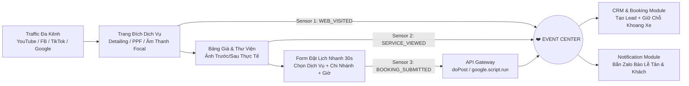

# (OFFICIAL) FILE 4: KIẾN TRÚC ỨNG DỤNG (APPLICATION ARCHITECTURE)
<!-- START_CONSTITUTION_TOC -->
## ⚡ MỤC LỤC TRA CỨU NHANH HIẾN PHÁP (FAST-LOOKUP CONSTITUTION TOC)
> **Quy tắc Bắt buộc (Mandatory Constitutional Scan & Verification Loop):**
> 1. **Trước mỗi Prompt/Yêu cầu:** AI Agent BẮT BUỘC quét nhanh bảng mục lục này (cùng mục lục của 4 file Hiến pháp còn lại) để định vị chính xác các chương liên quan trước khi đề xuất, thiết kế hoặc viết code.
> 2. **Vòng lặp Kiểm tra Chi tiết 1 Chương (`Deep-Chapter Verification Loop`):** Trong quá trình thực thi, bất cứ khi nào có dấu hiệu vi phạm Hiến pháp, có nghi vấn kiến trúc hoặc cần cẩn trọng kiểm tra lại, Agent BẮT BUỘC gọi `read_file` đọc trực tiếp đúng tọa độ dòng (`StartLine` – `EndLine`) của chương đó trong bảng dưới đây để đối chiếu 100% trước khi làm tiếp.

| Chương / Mục | Tọa độ Dòng (`Line Range`) | Tên Chương & Chủ đề Cốt lõi | Tóm tắt Quy tắc & Nội dung Trọng tâm |
| :--- | :---: | :--- | :--- |
| **Chương 1** | `L30–L79` | **Mục tiêu & 5 Quy tắc Chuyển hóa Ứng dụng** | FIELD_MAP Abstraction, Modular Monolith, Event-Driven, 4-Tier Language Strategy, Version Gating |
| **Chương 2** | `L80–L166` | **Data Architecture (10 Core Tables, 4 System Tables & Ma trận 4D FIELD_MAP)** | Chuẩn dòng 10/12, 6 cột hệ thống bắt buộc (id..audit_trail), 10 bảng nghiệp vụ & Tensor 4D (1D->4D) |
| **Chương 3** | `L167–L224` | **Module Map (Bản đồ 14-15 Phân hệ & Hợp đồng Giao tiếp)** | Đặc tả ranh giới Inputs, Outputs, Published/Subscribed Events của từng Module (M01->M15) |
| **Chương 4** | `L225–L279` | **Website Architecture (Cổng thông tin & Trạm Sensor Thu Lead)** | Kiến trúc Landing Page, Booking Funnel và Web Behavior Sensor |
| **Chương 5** | `L280–L338` | **UI Architecture (Thiết kế Giao diện — Simplicity First & OptiSync V5)** | AppStore trung tâm, Ghost RAM 15s, 8s Batch Truck, Giao diện Đa phòng ban & White-Label Theme |
| **Chương 6** | `L339–L404` | **API Architecture (4 Cổng RPC Hợp nhất & Webhook/MCP Gateway)** | api_query, api_mutate, api_batch_sync, doPost Webhook & KERNEL_McpHub |
<!-- END_CONSTITUTION_TOC -->


File này là bản vẽ thi công chi tiết ở tầng Ứng dụng, quy định lược đồ dữ liệu, ranh giới phân hệ, giao diện và giao thức API. Mô tả chi tiết và cụ thể vào phần thực thi cho từng chương ở file này so với các thông tin đã từng đề cập ở các file 1-2-3.

- Chương 1. Mục tiêu và phạm vi Application Architecture: Định vị vai trò của tầng ứng dụng, nguyên tắc chuyển hóa System Architecture thành các thành phần ứng dụng thực tế.
- Chương 2. Data Architecture (Kiến trúc Dữ liệu): Lược đồ Cơ sở dữ liệu vật lý (Database Schema, Tables, Data Types, Relationships) cho Master Database và Ma trận Ánh xạ Đa chiều (`FIELD_MAP` $n \times m \times k$).
- Chương 3. Module Map (Bản đồ Phân hệ): Thiết kế cấu trúc, ranh giới giao tiếp và đặc tả kỹ thuật của 11–14 khối chức năng lõi (Sales, Finance, Inventory, v.v.).
- Chương 4. Website Architecture (Kiến trúc Cổng thông tin): Sơ đồ luồng truy cập (Sitemap), luồng chuyển đổi (Funnel) và kiến trúc Component trên Website (Sensor thu Lead).
- Chương 5. UI Architecture (Kiến trúc Giao diện Người dùng): Design System, Component Library, nguyên tắc thiết kế UI/UX theo triết lý "Simplicity First" & "Optimistic UI (OptiSync V5)".
- Chương 6. API Architecture (Kiến trúc Giao thức Kết nối): Đặc tả các cổng giao tiếp API nội bộ và bên thứ ba (Endpoints, Request/Response Format, Authentication, Batch Sync).

---

# Chương 1. Mục tiêu và phạm vi Application Architecture

### 1. Mục tiêu chương
- Xác lập bản vẽ thi công thực tế (Implementation Blueprint) ở độ chi tiết **~70%**, chuyển hóa các khái niệm từ **Business Architecture (File 2)** và **System Architecture (File 3)** thành các bảng dữ liệu vật lý, hợp đồng giao tiếp phân hệ (Module Contracts), cấu trúc giao diện (UI Components) và giao thức kết nối (API/Event Payloads).
- Thiết lập ranh giới rõ ràng giữa **Logic Nghiệp vụ (Application & Business Layer)** và **Hạ tầng Công nghệ (Infrastructure Layer)** để đảm bảo khả năng chuyển đổi mượt mà từ **Phase 1 (Google Apps Script + Google Sheets)** sang **Phase 2 (Next.js + Node.js + PostgreSQL)** mà không phải viết lại quy tắc nghiệp vụ.
- Cung cấp chuẩn quy ước kỹ thuật thống nhất (100% Tiếng Anh ở tầng Codebase/Database/API, 100% Tiếng Việt ở tầng UI/UX) để cả kỹ sư phần mềm (Developer) và các tác nhân AI (AI Coding Agents) có thể đọc hiểu và sinh mã nguồn chính xác ngay từ lần đầu.

### 2. Vai trò trong toàn hệ thống
- Đóng vai trò là **"Cầu nối Thực thi" (Execution Bridge)** nằm giữa kiến trúc tổng thể 7 lớp (File 3) và hạ tầng vật lý (File 5).
- Ngăn chặn tình trạng lập trình viên hoặc AI Agent tự suy diễn cấu trúc bảng, đặt tên biến tùy tiện, hoặc viết các hàm gọi trực tiếp chéo nhau giữa các phân hệ gây ra nợ kỹ thuật (Technical Debt).
- Là tài liệu tham chiếu trực tiếp cho giai đoạn **Scaffolding (Dựng khung bằng CLI)** và **Coding (Viết logic bằng IDE)**.

### 3. Giải thích chi tiết

## 1.1 Nguyên tắc Chuyển hóa từ System Architecture sang Application Architecture
Mọi thành phần trong tầng Ứng dụng bắt buộc tuân thủ 5 quy tắc chuyển hóa cốt lõi:
1. **Tách biệt Giao diện và Lưu trữ qua Ma trận Ánh xạ (`FIELD_MAP` Abstraction):** Không một hàm nghiệp vụ hay giao diện nào được phép truy cập trực tiếp vào số thứ tự cột cố định (hardcoded column index như `row[2]`, `row[15]`) của Google Sheets. Toàn bộ thao tác Đọc/Ghi bắt buộc đi qua lớp từ điển ánh xạ trung tâm (`FIELD_MAP` / `GLOBAL_DB_MAP`).
2. **Cô lập Phân hệ trong một Codebase (`Modular Monolith`):** Ở Phase 1, toàn bộ mã nguồn nằm chung trong một dự án Google Apps Script để tiết kiệm chi phí gọi mạng (0đ), nhưng phải được phân tách nghiêm ngặt theo tiền tố tên file (`CRM_`, `WEB_`, `BOOKING_`, `FIN_`, `INV_`, `HR_`, `KERNEL_`, `EVENT_`).
3. **Giao tiếp Hướng Sự kiện (`Event-Driven Communication`):** Khi Phân hệ A hoàn tất một hành động nghiệp vụ (ví dụ: `BOOKING` tạo lịch hẹn mới), nó chỉ được phép ghi dữ liệu của chính nó và phát sự kiện (`EVENT_Center.publish("BOOKING_CREATED", payload)`). Phân hệ A tuyệt đối không gọi trực tiếp hàm của Phân hệ B (`CRM` hay `NOTIFY`).
4. **Chiến lược Ngôn ngữ 4 Tầng (4-Tier Language Strategy):**
   - **Codebase, Database Schema & API Keys:** 100% Tiếng Anh chuẩn `snake_case` (cho tên bảng/cột DB) và `camelCase` (cho biến/hàm JS).
   - **Tech Jargon:** Giữ nguyên thuật ngữ gốc (`Event`, `Publisher`, `Subscriber`, `Kernel`, `Payload`, `Sensor`, `Approval Node`).
   - **Tài liệu (Docs):** Song ngữ Anh – Việt.
   - **Giao diện (UI/UX):** 100% Tiếng Việt thuần túy, ngôn ngữ kinh doanh dễ hiểu cho SME.
5. **Kiểm soát Phạm vi theo Phiên bản (`Strict Version Gating V1 → V2 → V3`):**
   - **V1 (MVP Sinh tồn):** Chỉ kích hoạt `AUTH/KERNEL`, `EVENT`, `WEB`, `MKT`, `BOOKING`, `CRM`, `NOTIFY`, `AI_ASSIST` (Reactive).
   - **V2 (Vận hành Nội bộ):** Mở rộng `INVENTORY`, `POS`, `FINANCE`, `HR`, `AUTOMATION`, `KNOWLEDGE`.
   - **V3 (Hệ điều hành Thông minh):** Kích hoạt `AI_BRAIN` chủ động 5 tầng, `BI_BENCHMARK`, `BEHAVIOR_HEATMAP`.

### 4. Ví dụ minh họa
- **Kịch bản Thực tế tại AP CAR CARE (Ngành Detailing & Phụ kiện Ô tô):**
  - Khách hàng đặt lịch "Phủ Ceramic Gói Diamond" trên trang Landing Page.
  - Tầng **Website (`WEB_Sensor`)** thu thập thông tin và gửi qua **API Gateway (`KERNEL_Gateway`)**.
  - Phân hệ **Booking (`BOOKING_Service`)** kiểm tra quy tắc trùng ca/khoang xe (`Booking Rules`), lưu bản ghi vào bảng `bookings` thông qua `BOOKING_FIELD_MAP`, sau đó phát sự kiện `BOOKING_CREATED` lên `EVENT_Center`.
  - `EVENT_Center` tự động kích hoạt `CRM_Service` (cập nhật hồ sơ khách hàng) và `NOTIFY_Service` (bắn thông báo Zalo cho Lễ tân chi nhánh Q7/Tân Phú). Toàn bộ luồng diễn ra độc lập, nếu tắt AI thì luồng đặt lịch vẫn hoạt động 100%.

### 5. Best Practice
- **Zero Hardcode Policy:** Cấm tuyệt đối việc gán cứng ID Google Sheets, tên cột tiếng Việt, hoặc quyền hạn nhân sự bên trong hàm xử lý logic. Tất cả phải khai báo tại file cấu hình trung tâm (`KERNEL_Config.js` & `KERNEL_FieldMap.js`).
- **Contract-First Development:** Trước khi viết bất kỳ dòng code nào bên trong hàm, phải định nghĩa rõ Đầu vào (`Input Payload`), Đầu ra (`Output Response`) và Sự kiện phát sinh (`Emitted Events`).

### 6. Checklist
- [ ] Đã tách bạch hoàn toàn các hàm xử lý logic nghiệp vụ khỏi các lệnh gọi trực tiếp `SpreadsheetApp` chưa?
- [ ] Tên biến, tên hàm, tên bảng và trường JSON đã tuân thủ 100% Tiếng Anh chưa?
- [ ] Các phân hệ đã được kiểm tra để đảm bảo không có bất kỳ lời gọi hàm trực tiếp chéo nhau nào chưa?

### 7. Các điểm cần quyết định
- **[ĐÃ CHỐT]:** Áp dụng kiến trúc `Modular Monolith` kết hợp `FIELD_MAP Pattern` cho Phase 1 trên Google Apps Script để đảm bảo tốc độ phát triển nhanh nhất (80/20) và sẵn sàng nâng cấp lên Next.js/PostgreSQL ở Phase 2.

---

# Chương 2. Data Architecture (Kiến trúc Dữ liệu & Ma trận FIELD_MAP Đa chiều)

### 1. Mục tiêu chương
- Thiết kế lược đồ cơ sở dữ liệu vật lý (Physical Database Schema) cho **Master Database**, đảm bảo nguyên tắc **One Source of Truth (SSOT)** và **No Data Duplication**.
- Chuẩn hóa cấu trúc của **10 Đối tượng Kinh doanh Cốt lõi (Core Business Objects)** từ Chương 9 File 2 cùng 4 bảng vận hành hệ thống (System Tables).
- Định nghĩa kiến trúc **Ma trận Ánh xạ Dữ liệu Đa chiều (`Multi-Dimensional FIELD_MAP Matrix` $1D \rightarrow 2D \rightarrow 3D \rightarrow 4D$)** nhằm tự động hóa hoàn toàn việc đọc/ghi, phân quyền hiển thị, kiểm tra hợp lệ và biến đổi dữ liệu giữa Backend (Google Sheets / SQL) và Frontend (SPA UI).

### 2. Vai trò trong toàn hệ thống
- Là **"Trái tim Lưu trữ" (Data Backbone)** của toàn bộ hệ sinh thái SME OS.
- Giúp hệ thống miễn nhiễm với lỗi "lệch cột kinh điển" trên Google Sheets khi người dùng hoặc quản trị viên chèn/xóa/di chuyển cột.
- Tạo nền tảng dữ liệu sạch, có cấu trúc chuẩn và gắn nhãn thời gian (`Timestamp`) để **AI Brain** có thể đọc hiểu ngay lập tức mà không cần bước tiền xử lý phức tạp.

### 3. Giải thích chi tiết

## 2.1 Tiêu chuẩn Thiết kế Bảng Vật lý (Universal Table Standards)
Mọi bảng dữ liệu (Sheet trong Phase 1 / Table trong Phase 2) trong Master Database bắt buộc phải có **6 trường hệ thống tiêu chuẩn (System Metadata Columns)**:
1. `id` (`STRING / UUID`, Primary Key): Định danh duy nhất có tiền tố theo thực thể (VD: `CUS_0001`, `BKG_20261011_01`, `INV_0001`, `TSK_0001`).
2. `tenant_id` (`STRING`): Mã định danh doanh nghiệp (mặc định ở Phase 1 là `AP_CAR_CARE`).
3. `branch_id` (`STRING`): Mã chi nhánh phục vụ Multi-Branch (VD: `HQ`, `BR_Q7`, `BR_TANPHU`).
4. `status` (`ENUM / STRING`): Trạng thái vòng đời của bản ghi (luôn viết hoa hoặc chuẩn hóa theo danh mục `catalog`).
5. `created_at` & `updated_at` (`ISO_DATETIME`): Thời gian tạo và cập nhật gần nhất (`yyyy-MM-dd HH:mm:ss`).
6. `audit_trail` (`JSON_ARRAY`, System-Only): Cột lưu vết lịch sử chỉnh sửa bất biến, khóa quyền ghi đối với người dùng cuối.

*(Quy ước bố cục dòng trên Google Sheets ở Phase 1 kế thừa chuẩn thực chiến từ TDCM Team App: Dòng 1–9 dành cho Dashboard mini/Cấu hình tổng, **Dòng 10 là `HEADER_ROW`**, **Dòng 11 là dòng mô tả/hướng dẫn**, và **dữ liệu thật bắt đầu từ Dòng 12 (`MIN_DATA_ROW = 12`)**).*

## 2.2 Lược đồ 10 Bảng Đối tượng Kinh doanh Cốt lõi (10 Core Business Object Schemas)

| STT | Tên Bảng (Table / Sheet Key) | Mã Tiền tố ID | Các Trường Dữ liệu Vật lý Cốt lõi (`frontendKey` : `DataType`) | Phiên bản Rollout |
|---|---|---|---|---|
| **1** | **`customers`** *(Khách hàng)* | `CUS_` | `id` (string), `full_name` (string), `phone` (string - Unique Index), `email` (string), `customer_tier` (select: New/Silver/Gold/VIP), `source_channel` (select: Web/FB/TikTok/Zalo/Walk-in), `vehicle_list_json` (json: biển số, hãng xe, dòng xe, đời xe), `total_spent` (number), `last_visit_date` (date), `assigned_sale_id` (ref->employees), `notes` (text), `branch_id`, `status`, `audit_trail` | **V1 (MVP)** |
| **2** | **`employees`** *(Nhân sự)* | `EMP_` | `id` (string), `username` (string), `password_hash` (string), `full_name` (string), `phone_zalo` (string), `email` (string), `role_code` (select: PO/CEO/MANAGER/ADMIN/SALE/MKT/TECH/RECEPTION/PARTNER), `department` (string), `branch_id` (string), `avatar_url` (string), `theme_color` (string), `kpi_score` (number), `salary_history_json` (json), `status` | **V1 (Auth) / V2 (HR)** |
| **3** | **`products`** *(Sản phẩm / Phụ kiện / Vật tư)* | `PRD_` | `id` (string), `sku` (string), `product_name` (string), `category` (select: Detailing_Chemical/PPF_Film/Audio_Focal/Accessory), `unit` (string), `cost_price` (number - **Visible=false với Sale/Tech**), `retail_price` (number), `dealer_price` (number - dành cho Đối tác/Đại lý), `stock_qty` (number), `min_stock_threshold` (number), `supplier_id` (ref->suppliers), `status` | **V1 (Catalog) / V2 (Inventory)** |
| **4** | **`services`** *(Dịch vụ Kỹ thuật)* | `SRV_` | `id` (string), `service_code` (string), `service_name` (string), `service_group` (select: Ceramic/PPF/Wash_Detailing/Sound_Upgrade/Maintenance), `standard_duration_mins` (number), `base_price` (number), `warranty_months` (number), `consumable_bom_json` (json: định mức vật tư tiêu hao), `commission_rate` (float), `status` | **V1 (MVP)** |
| **5** | **`suppliers`** *(Nhà cung cấp / Đối tác)* | `SUP_` | `id` (string), `supplier_name` (string), `contact_person` (string), `phone` (string), `product_groups` (string), `payable_debt` (number), `rating` (number), `contract_files_json` (json), `status` | **V2 (Operation)** |
| **6** | **`invoices`** *(Hóa đơn / Chứng từ Tài chính)* | `INV_` | `id` (string), `booking_id` (ref->bookings), `customer_id` (ref->customers), `items_json` (json: danh sách SP/DV, số lượng, đơn giá, chiết khấu), `subtotal` (number), `discount_amount` (number), `total_amount` (number), `paid_amount` (number), `debt_amount` (number), `payment_method` (select: Cash/Transfer/Card), `cashier_id` (ref->employees), `branch_id`, `status` (DRAFT/PAID/PARTIAL/CANCELLED), `audit_trail` | **V2 (Finance/POS)** |
| **7** | **`bookings`** *(Lịch hẹn & Lệnh sửa chữa/chăm sóc xe)* | `BKG_` | `id` (string), `customer_id` (ref->customers), `customer_name` (string), `customer_phone` (string), `license_plate` (string), `car_model` (string), `service_ids_json` (json), `scheduled_time` (datetime), `bay_slot` (string: Khoang thi công), `lead_tech_id` (ref->employees), `before_images_json` (json), `after_images_json` (json), `branch_id`, `status` (PENDING/CONFIRMED/IN_PROGRESS/QC_CHECK/COMPLETED/CANCELLED), `audit_trail` | **V1 (MVP)** |
| **8** | **`campaigns`** *(Chiến dịch & Bài đăng Đa kênh)* | `CMP_` | `id` (string), `campaign_name` (string), `post_content` (text), `media_urls_json` (json), `channels_json` (json: YouTube/Facebook/TikTok/Website status `v`/`x`), `budget_limit` (number), `actual_cost` (number), `leads_generated` (number), `author_id` (ref->employees), `published_at` (datetime), `status` | **V1 (Marketing Hub)** |
| **9** | **`tasks`** *(Công việc / Giao việc Vận hành & Content)* | `TSK_` | `id` (string), `project_name` (string), `task_type` (select), `task_title` (string), `task_description` (text), `assignee_id` (ref->employees), `assigner_id` (ref->employees), `priority` (select: LOW/MEDIUM/HIGH), `start_date` (date), `due_date` (date), `completed_date` (date), `submission_link` (url), `chat_review_json` (json), `unit_price` (number), `project_charge` (number), `schedule_config_json` (json), `status` (TODO/ACCEPTED/IN_PROGRESS/NEED_FIX/WAIT_PUBLISH/COMPLETED) | **V1 (MVP)** |
| **10** | **`assets`** *(Tài sản & Thiết bị Xưởng/Media)* | `AST_` | `id` (string), `asset_code` (string), `asset_name` (string), `asset_category` (select: Garage_Tool/Media_Gear/IT_Device), `branch_id` (string), `holder_employee_id` (ref->employees), `purchase_value` (number), `maintenance_cycle_days` (number), `next_maintenance_date` (date), `status` (ACTIVE/MAINTENANCE/BROKEN) | **V2 (Operation)** |

## 2.3 Lược đồ 4 Bảng Vận hành Hệ thống (System Kernel & Event Tables)
1. **`sys_events` (Trục Sự kiện Event Center):** `event_id`, `event_name` (VD: `LEAD_CREATED`, `BOOKING_CONFIRMED`), `source_module`, `entity_id`, `payload_json`, `processed_status` (`PENDING` / `PROCESSED` / `FAILED`), `retry_count`, `created_at`.
2. **`sys_dead_letter_queue` (Hàng đợi Lỗi DLQ):** `dlq_id`, `event_id`, `error_message`, `stack_trace`, `payload_json`, `resolved_by`, `status`.
3. **`sys_notifications` (Cổng Thông tin & Cảnh báo):** `notify_id`, `notify_type`, `sender_id`, `receiver_role_or_id`, `content`, `severity` (`INFO` / `WARNING` / `CRITICAL`), `read_history_json`, `state_flag` (`1` = Active, `0` = Closed), `created_at`.
4. **`sys_audit_logs` (Nhật ký Kiểm toán 3.000 dòng cuốn chiếu):** `log_id`, `timestamp`, `actor_id`, `action_type`, `target_entity`, `change_diff` (`old_val -> new_val`).

## 2.4 Kiến trúc Ma trận `FIELD_MAP` Đa chiều ($1D \rightarrow 2D \rightarrow 3D \rightarrow 4D$)
Để đáp ứng sự phát triển từ đơn giản đến phức tạp của dự án mà **không bao giờ phải sửa lại hàm đọc/ghi lõi**, hệ thống chuẩn hóa cấu trúc `FIELD_MAP` theo 4 cấp độ không gian (Dimensions):

- **Chiều 1 ($1D$ — Vector Thuộc tính Trường đơn):** Ánh xạ tên trường logic sang tọa độ cột vật lý trên Sheet (`col`, `idx`, `sheetHeader`, `frontendKey`, `type`, `defaultVal`).
- **Chiều 2 ($2D$ — Ma trận Đa Bảng $n \times m$: `Table` $\times$ `Field`):** Quản lý tập trung toàn bộ các bảng trong `GLOBAL_DB_MAP[tableName][fieldKey]`. Một hàm `readTableByMap(tableName)` duy nhất có thể đọc bất kỳ bảng nào trong 14 bảng của hệ thống.
- **Chiều 3 ($3D$ — Ma trận Phân quyền & Ngữ cảnh Vai trò $n \times m \times k$: `Table` $\times$ `Field` $\times$ `Role/View`):** Quyết định tại từng giao điểm `(Bảng, Cột, Vai trò)` xem người dùng đó được phép **Xem (`visible`)**, **Sửa (`editable`)**, hay **Bắt buộc nhập (`required`)** — ví dụ: cột `cost_price` (Giá vốn) có `permissions: { PO: "RW", MANAGER: "R", SALE: "NONE", TECH: "NONE", CUSTOMER: "NONE" }`.
- **Chiều 4 ($4D$ — Siêu Ma trận Trạng thái Động & Đa Chi nhánh $n \times m \times k \times t$: `Table` $\times$ `Field` $\times$ `Role` $\times$ `LifecycleState/Branch`):** Kết hợp với `AUTOMATION_RULE_ENGINE` — quyền sửa một ô tự động đóng băng (Lock) hoặc mở khóa tùy theo **Trạng thái dòng hiện tại (`status`)** và **Chi nhánh (`branch_id`)**. Ví dụ: Khi `bookings.status == "COMPLETED"`, toàn bộ các cột dịch vụ và đơn giá tự động chuyển sang trạng thái khóa (`LOCKED`) đối với `RECEPTION` và `TECH`, chỉ `PO` mới có quyền mở khóa.

```javascript
// MẪU CHUẨN KIẾN TRÚC MA TRẬN FIELD_MAP ĐA CHIỀU (n x m x k x t) TRONG SME OS
const GLOBAL_SCHEMA_MATRIX = {
  bookings: {
    _meta: { sheetName: "Bookings", headerRow: 10, minDataRow: 12, primaryKey: "id" },
    fields: {
      id:             { col: "B", sheetHeader: "Mã Booking",   type: "string",   permissions: { PO: "R",  RECEPTION: "R",  TECH: "R",  CUSTOMER: "R" }, lockOnStatus: ["*"] },
      customer_phone: { col: "E", sheetHeader: "SĐT Khách",    type: "phone",    permissions: { PO: "RW", RECEPTION: "RW", TECH: "NONE", CUSTOMER: "R" }, lockOnStatus: ["COMPLETED", "CANCELLED"] },
      service_ids:    { col: "H", sheetHeader: "Gói Dịch Vụ",  type: "json_arr", permissions: { PO: "RW", RECEPTION: "RW", TECH: "R",  CUSTOMER: "R" }, lockOnStatus: ["COMPLETED"] },
      dealer_price:   { col: "M", sheetHeader: "Giá Đại Lý",   type: "currency", permissions: { PO: "RW", PARTNER: "R",    RECEPTION: "NONE", TECH: "NONE" }, lockOnStatus: ["COMPLETED"] },
      status:         { col: "O", sheetHeader: "Trạng Thái",   type: "enum",     permissions: { PO: "RW", RECEPTION: "RW", TECH: "RW", CUSTOMER: "R" }, lockOnStatus: ["CANCELLED"] }
    }
  }
};
```

### 4. Ví dụ minh họa
- **Tự động lọc dữ liệu nhạy cảm bằng Ma trận $3D$:** Khi một Kỹ thuật viên (`role = TECH`) mở chi tiết xe đang làm dịch vụ ở chi nhánh Tân Phú, hàm Backend `queryEntity("bookings", userSession)` duyệt qua `GLOBAL_SCHEMA_MATRIX.bookings.fields`. Các trường có `permissions.TECH === "NONE"` (như `customer_phone` và `dealer_price`) tự động bị cắt bỏ khỏi JSON Payload ngay tại Server trước khi trả về trình duyệt. Kỹ thuật viên mở F12 DevTools cũng không thể thấy số điện thoại khách hay giá vốn/giá đại lý.

### 5. Best Practice
- **Đọc 1 Lần Bằng Snapshot (`getDatabaseSnapshot`):** Mọi thao tác đọc bảng trên Google Sheets bắt buộc gọi `getRange().getValues()` đúng 1 lần duy nhất đưa lên RAM, sau đó dùng vòng lặp qua `GLOBAL_SCHEMA_MATRIX` để bóc tách. Tuyệt đối cấm gọi `getValue()` bên trong vòng lặp `for`.
- **Lưu JSON Gọn Nhẹ trong Ô Phức hợp:** Với các dữ liệu có cấu trúc 1-nhiều nhẹ ở Phase 1 (như lịch sử chat trong task `chat_review_json`, danh sách xe của khách `vehicle_list_json`), đóng gói thành chuỗi JSON chuẩn lưu trong 1 cột nhưng phải giới hạn kích thước `< 45.000 ký tự/ô` (tránh giới hạn 50.000 ký tự của Google Sheets). Ảnh/File bắt buộc lưu lên Google Drive và chỉ lưu URL/FileID vào JSON.

### 6. Checklist
- [ ] Toàn bộ 10 bảng nghiệp vụ và 4 bảng hệ thống đã khai báo đầy đủ trong `GLOBAL_SCHEMA_MATRIX` chưa?
- [ ] Đã loại bỏ 100% các con số chỉ mục cột cố định (`row[0]`, `row[5]`) trong mã nguồn chưa?
- [ ] Các trường nhạy cảm (Giá vốn `cost_price`, SĐT khách hàng `customer_phone`, Mật khẩu `password_hash`) đã được gắn cờ phân quyền theo Role trong Ma trận $3D$ chưa?

### 7. Các điểm cần quyết định
- **[ĐÃ CHỐT]:** Sử dụng cấu trúc **Siêu Ma trận `GLOBAL_SCHEMA_MATRIX` ($n \times m \times k \times t$)** làm chuẩn bắt buộc duy nhất cho toàn bộ tương tác Database – Backend – Frontend của dự án.

---

# Chương 3. Module Map (Bản đồ Phân hệ & Ranh giới Giao tiếp)

### 1. Mục tiêu chương
- Quy hoạch chi tiết 14 khối chức năng (Modules) của SME OS thành các đơn vị mã nguồn độc lập, có quy chuẩn đặt tên file, đầu vào/đầu ra và danh mục Sự kiện (Events) rõ ràng.
- Thực thi nghiêm ngặt nguyên lý **Modular Forever** và **No Direct Module Dependency**: Cấm 100% các phân hệ gọi hàm trực tiếp của nhau; mọi tác động liên phân hệ bắt buộc đi qua **Event Center**.

### 2. Vai trò trong toàn hệ thống
- Là **"Bản đồ Quy hoạch Đô thị" (Urban Zoning Map)** của phần mềm, giúp lập trình viên và AI Agent biết chính xác mỗi tính năng thuộc về file nào, hàm nào, được phép đọc bảng nào và phát ra sự kiện gì.
- Cho phép doanh nghiệp SME bật/tắt (Toggle) từng phân hệ theo gói dịch vụ (V1, V2, V3) mà không làm sập các phân hệ đang chạy.

### 3. Giải thích chi tiết

## 3.1 Quy chuẩn Đặt tên File & Phân vùng Mã nguồn (Naming Convention)
Mọi file mã nguồn trong thư mục `src/` bắt buộc đặt tên theo công thức: **`[PREFIX]_[ModuleName].gs`** (Backend) và **`UI_[ViewName].html`** (Frontend).

## 3.2 Đặc tả Kỹ thuật & Hợp đồng Giao tiếp của 14 Phân hệ Lõi

| STT | Mã Tiền tố & Tên Phân hệ | Bảng Dữ liệu Sở hữu (Master Owner) | Chức năng Nghiệp vụ Cốt lõi | Sự kiện Phát ra (`Published Events`) | Sự kiện Lắng nghe (`Subscribed Events`) | Phiên bản |
|---|---|---|---|---|---|---|
| **1** | **`KERNEL_` (Business Kernel & Auth)** | `employees`, `sys_audit_logs` | Xác thực đăng nhập (`checkLogin`), kiểm tra Ma trận Phân quyền 4 chiều (`canPerformAction`), quản lý cấu hình hệ thống & ghi vết `writeAuditLog`. | `USER_LOGGED_IN`, `PERMISSION_DENIED` | `*` (Ghi Audit Log cho mọi sự kiện thay đổi dữ liệu) | **V1** |
| **2** | **`EVENT_` (Event Center & Queue)** | `sys_events`, `sys_dead_letter_queue` | Trục thần kinh trung tâm: Nhận sự kiện (`publishEvent`), định tuyến tới các Subscriber (`dispatchSubscribers`), xử lý thử lại (Retry) và đẩy lỗi vào `DLQ`. | `EVENT_FAILED_TO_DLQ` | Toàn bộ sự kiện từ các phân hệ | **V1** |
| **3** | **`WEB_` (Website & Portal Sensor)** | *(Không lưu bảng riêng, đẩy thẳng vào Event)* | Cung cấp Widget Đặt lịch/Đăng ký, thu thập hành vi khách hàng trên Web/Landing Page và bắn tín hiệu về hệ thống. | `WEB_VISITED`, `BANNER_CLICKED`, `LEAD_SUBMITTED` | `CAMPAIGN_PUBLISHED` | **V1** |
| **4** | **`MKT_` (Marketing & Multi-Channel Hub)** | `campaigns` | Quản lý chiến dịch, Hub Đăng bài Đa kênh (YouTube, Facebook, TikTok), theo dõi ngân sách/chi phí thực tế MKT và đo lường hiệu quả tạo Lead. | `POST_PUBLISHED`, `CAMPAIGN_BUDGET_ALERT` | `LEAD_CREATED`, `INVOICE_PAID` (Tính ROI chiến dịch) | **V1** |
| **5** | **`BOOKING_` (Booking & Service Bay)** | `bookings`, `services` | Quản lý đặt lịch hẹn chăm sóc/nâng cấp xe, điều phối khoang dịch vụ (Bay Slot), cập nhật tiến độ thi công & ảnh nghiệm thu Trước/Sau (Before/After). | `BOOKING_CREATED`, `BOOKING_STATUS_CHANGED`, `BOOKING_COMPLETED` | `PAYMENT_CONFIRMED` | **V1** |
| **6** | **`CRM_` (Customer Relationship)** | `customers` | Quản lý hồ sơ 360 độ của Khách hàng & Danh sách xe, phân hạng thành viên, lịch sử chăm sóc và nhắc lịch bảo dưỡng định kỳ. | `LEAD_CREATED`, `CUSTOMER_TIER_UPGRADED`, `MAINTENANCE_DUE` | `LEAD_SUBMITTED`, `BOOKING_COMPLETED`, `INVOICE_PAID` | **V1** |
| **7** | **`TASK_` (Task & Operation Workflow)** | `tasks` | Giao việc nội bộ & đội ngũ Content/Kỹ thuật, quản lý trạng thái công việc, hẹn lịch tạo task tự động (Scheduled Tasks), khung Chat/Review duyệt việc. | `TASK_CREATED`, `TASK_SUBMITTED`, `TASK_APPROVED`, `TASK_OVERDUE` | `BOOKING_CREATED` (Tự tạo task kỹ thuật), `LEAD_CREATED` (Tự tạo task gọi khách cho Sale) | **V1** |
| **8** | **`NOTIFY_` (Notification Center)** | `sys_notifications` | Trạm phát thông báo nội bộ trên App (Scrolling Ticker / Popup Banner) và gửi tin nhắn ra ngoài qua Zalo Bot / ZNS / Email. | `NOTIFICATION_SENT`, `ZALO_DELIVERY_FAILED` | `BOOKING_CREATED`, `TASK_OVERDUE`, `AI_ALERT_RAISED`, `INVOICE_PAID` | **V1** |
| **9** | **`AI_` (AI Brain & Copilot Gateway)** | *(Đọc Event Stream & Master DB qua Read-Only Snapshot)* | Thực thi chu trình 5 tầng (`Observe → Detect → Diagnose → Recommend → Execute`), sinh thẻ gợi ý thông minh (`Contextual AI Cards`) và quản lý chốt chặn `Approval Node`. | `AI_INSIGHT_GENERATED`, `AI_APPROVAL_REQUESTED`, `AI_ACTION_EXECUTED` | Toàn bộ Business Events quan trọng | **V1 (Draft) / V3 (Full)** |
| **10** | **`INV_` (Inventory & Warehouse)** | `products`, `suppliers` | Quản lý nhập-xuất-tồn phụ kiện/dung dịch Detailing theo chi nhánh, trừ kho tự động theo định mức (BOM) và cảnh báo chạm ngưỡng tồn tối thiểu. | `STOCK_DEDUCTED`, `LOW_STOCK_DETECTED`, `PURCHASE_ORDER_NEEDED` | `BOOKING_COMPLETED`, `POS_ORDER_CHECKOUT` | **V2** |
| **11** | **`POS_` (Point of Sale)** | *(Ghi nhận giao dịch quầy)* | Giao diện thu ngân nhanh tại quầy, quét mã phụ kiện/dịch vụ, áp dụng khuyến mãi và kích hoạt tạo hóa đơn. | `POS_ORDER_CHECKOUT` | `BOOKING_COMPLETED` | **V2** |
| **12** | **`FIN_` (Finance & Accounting)** | `invoices` | Quản lý doanh thu, thực chi, công nợ khách hàng/đối tác, đối soát định phí/biến phí và tự động kiểm tra chênh lệch đơn giá. | `INVOICE_CREATED`, `INVOICE_PAID`, `PRICE_MISMATCH_DETECTED` | `POS_ORDER_CHECKOUT`, `TASK_APPROVED` | **V2** |
| **13** | **`HR_` (Human Resources & Payroll)** | `employees` (nhánh lương/chấm công) | Chấm công bằng hình ảnh/GPS, tính hoa hồng kỹ thuật viên/sale và tổng hợp bảng lương tự động theo kỳ. | `ATTENDANCE_CHECKED_IN`, `PAYROLL_CALCULATED` | `BOOKING_COMPLETED`, `TASK_APPROVED` | **V2** |
| **14** | **`AUTO_` & `DOC_` (Automation & Knowledge)** | `assets` + kho SOP | Nhà máy Robot chạy ngầm theo lịch (`Master Scheduler` + `Worker Bots` dọn dữ liệu, chốt task) và thư viện quy trình SOP/Đào tạo nội bộ. | `CRON_BATCH_EXECUTED` | Time-driven Triggers (Mỗi giờ / Hàng đêm) | **V2** |

### 4. Ví dụ minh họa
- **Luồng Phối hợp Liên Phân hệ Không Gọi Chéo (Zero Direct Call):**
  - Khi Kỹ thuật viên bấm hoàn tất rửa xe & phủ Ceramic trên màn hình Kỹ thuật:
  - Phân hệ `BOOKING_` chỉ cập nhật `bookings.status = "COMPLETED"` và gọi `EVENT_Center.publish("BOOKING_COMPLETED", { bookingId, customerId, serviceIds, techId })`.
  - Ngay tại `EVENT_Center`, 4 phân hệ đang đăng ký lắng nghe (`Subscribe`) sẽ tự động nhận tín hiệu:
    1. `CRM_` cộng điểm tích lũy và hẹn lịch bảo dưỡng lớp phủ sau 6 tháng.
    2. `INV_` (ở V2) tự động trừ định mức 30ml dung dịch Ceramic trong kho.
    3. `FIN_` tạo nháp phiếu thu cho Lễ tân thu tiền.
    4. `HR_` cộng điểm KPI/Hoa hồng ca làm việc cho Kỹ thuật viên.

### 5. Best Practice
- **Strict Ownership Rule (Quy tắc Chủ sở hữu Bảng):** Mỗi bảng dữ liệu chỉ có **DUY NHẤT 1 phân hệ được quyền Ghi (`Write Owner`)**. Các phân hệ khác muốn thay đổi dữ liệu bảng đó bắt buộc phải phát Event yêu cầu phân hệ chủ sở hữu xử lý.
- **Tập trung Robot Ngầm về 1 Trạm (`Centralized Worker Bots`):** Kế thừa kiến trúc `Automation.gs` của TDCM Team App, toàn bộ các tác vụ quét dữ liệu định kỳ phải nhận chung 1 bản `snapshot` từ `getDatabaseSnapshot()`, tuyệt đối không để mỗi Bot tự mở Sheet đọc lại từ đầu.

### 6. Checklist
- [ ] Mỗi phân hệ đã được gán duy nhất các bảng mà nó làm chủ sở hữu (`Write Owner`) chưa?
- [ ] Danh sách `Published Events` và `Subscribed Events` của từng phân hệ đã khớp nối 100% với nhau chưa?
- [ ] Đã khóa các phân hệ thuộc V2/V3 vào danh sách chờ (Backlog) để tập trung 100% nguồn lực hoàn thiện V1 chưa?

### 7. Các điểm cần quyết định
- **[ĐÃ CHỐT]:** Giữ nguyên cấu trúc 1 file `src/Code.gs` + `src/Index.html` hiện hành cho các tính năng đang chạy ổn định của App AP CAR CARE; khi mở rộng thêm các phân hệ V1 tiếp theo (`BOOKING`, `CRM`, `EVENT`), sẽ xin phép Product Owner trước khi tách/tạo file module mới trong `src/`.

---

# Chương 4. Website Architecture (Kiến trúc Cổng thông tin & Trạm Sensor Thu Lead)

### 1. Mục tiêu chương
- Thiết kế kiến trúc cho phân hệ **Website / Landing Page / Customer Portal** đóng vai trò là "Mặt tiền số" và "Hệ thống Cảm biến (Sensors)" thu thập khách hàng tiềm năng (Leads) và lịch hẹn (Bookings) theo thời gian thực.
- Đảm bảo 100% tương tác quan trọng của khách hàng trên Website đều được chuyển hóa thành sự kiện chuẩn đẩy về **Event Center** và **CRM**.

### 2. Vai trò trong toàn hệ thống
- Là **"Phễu Đầu Vào" (Top-of-Funnel Acquisition Engine)** tạo ra doanh thu trực tiếp ở Giai đoạn V1 (Sinh tồn).
- Giúp giải quyết điểm đau lớn nhất của các chủ doanh nghiệp dịch vụ ô tô (ICP Persona 1, 2, 3): chi tiền chạy quảng cáo nhưng không biết khách đến từ kênh nào và rơi rụng ở bước nào.

### 3. Giải thích chi tiết

## 4.1 Sơ đồ Cấu trúc Cổng thông tin (Sitemap & Funnel Flow)


## 4.2 Kiến trúc 3 Lớp của Website & Bộ Cảm biến (`WEB_Sensor`)
1. **Lớp Trình diễn Thương hiệu (Ultra-Luxury Brand Showcase):**
   - Hiển thị các gói dịch vụ chủ lực của AP CAR CARE (Phủ Ceramic, Dán PPF, Cách âm & Âm thanh Focal, Bảo dưỡng nội ngoại thất) với hình ảnh trực quan, rõ giá, rõ thời gian thi công.
2. **Lớp Chuyển đổi Tức thì (30-Second Booking & Lead Widget):**
   - Form đặt lịch tối giản chỉ gồm **3 trường bắt buộc**: `Số điện thoại`, `Biển số / Dòng xe`, `Dịch vụ & Chi nhánh (Q7 / Tân Phú)`. Khách hàng hoàn tất thao tác trong dưới 15 giây.
3. **Lớp Cảm biến Hành vi (`WEB_Sensor.js` Embed SDK):**
   - Đoạn mã JavaScript siêu nhẹ (`< 5KB`) có thể nhúng trực tiếp vào Web App hoặc bất kỳ trang WordPress/Landing Page sẵn có nào của doanh nghiệp.
   - Tự động bóc tách các tham số nguồn chiến dịch (`utm_source`, `utm_medium`, `utm_campaign`, `ref_partner_id` của Đại lý/CTV) và đính kèm vào gói tin `Event Payload` khi gửi về Backend `doPost(e)`.

### 4. Ví dụ minh họa
- **Truy vết Khách hàng từ Bài đăng Đa kênh đến Xưởng dịch vụ:**
  - Anh Đức dùng **Hub Đăng bài Đa kênh** trên trang Home đăng 1 bài kèm video "Nâng cấp loa Focal cho Mercedes S450" lên Facebook và TikTok (mã chiến dịch `CMP_202610_05`).
  - Khách hàng bấm vào link gắn mã `?utm_campaign=CMP_202610_05` và đặt lịch qua Widget.
  - `WEB_Sensor` bắt trọn vẹn mã `CMP_202610_05` gửi kèm sự kiện `BOOKING_CREATED`. Nhờ đó, hệ thống tự động cộng `leads_generated + 1` vào đúng bài đăng đó trên bảng `campaigns`, giúp CEO biết chính xác bài đăng nào mang lại tiền thật.

### 5. Best Practice
- **Chống Spam & Rác Dữ liệu tại Cổng (`Rate Limit & Honeypot`):** Mọi Form công khai trên Website phải có trường ẩn `honeypot` và kiểm tra định dạng số điện thoại Việt Nam hợp lệ (`/^0[35789]\d{8}$/`) kèm khóa chống gửi trùng lặp trong 60 giây cho cùng 1 số điện thoại.
- **Async Non-blocking Tracking:** Việc gửi các sự kiện quan sát hành vi (`WEB_VISITED`, `BANNER_CLICKED`) phải chạy bất đồng bộ (`navigator.sendBeacon` hoặc `fetch(..., { keepalive: true })`), tuyệt đối không làm chậm tốc độ tải trang của khách hàng.

### 6. Checklist
- [ ] Form Đặt lịch / Thu Lead trên Website đã rút gọn tối đa để khách hàng điền xong dưới 30 giây chưa?
- [ ] Gói tin gửi từ Website về Backend đã tự động đính kèm các tham số `utm_source`, `utm_campaign` và `branch_id` chưa?
- [ ] Đã có bộ lọc chặn số điện thoại ảo và chống spam gửi liên tục chưa?

### 7. Các điểm cần quyết định
- **[ĐÃ CHỐT]:** Ở Phase 1, cổng đặt lịch cho Khách hàng và Đối tác được tích hợp trực tiếp trong cùng nền tảng SPA Web App của AP CAR CARE, đồng thời cung cấp Webhook `doPost(e)` để nhận Lead từ Website/Landing Page bên ngoài.

---

# Chương 5. UI Architecture (Kiến trúc Giao diện Người dùng — Simplicity First & OptiSync V5)

### 1. Mục tiêu chương
- Quy định kiến trúc kỹ thuật và tiêu chuẩn thẩm mỹ cho tầng Giao diện Người dùng (Frontend Layer), kết hợp hoàn hảo giữa:
  1. **Triết lý Simplicity First (Rule of 30 Seconds, SUS > 80, 100% Tiếng Việt)** của SME OS.
  2. **Chuẩn thẩm mỹ Ultra-Luxury Automotive Studio (`hq/design_aesthetic_memo.md`)** của thương hiệu AP CAR CARE.
  3. **Kiến trúc Động cơ Logistics & Giao diện Lạc quan V5 (`OptiSync V5`: Central AppStore, Ghost RAM 15s, Debounce Batching 8s, Smart Polling, Data Mixer)** kế thừa từ TDCM Team App.

### 2. Vai trò trong toàn hệ thống
- Là **"Điểm chạm Trực tiếp" (Human Touchpoint)** quyết định nhân sự SME (CEO, Lễ tân, Thợ kỹ thuật, Sale) có yêu thích và sử dụng phần mềm hàng ngày hay bỏ cuộc.
- Giải quyết triệt để điểm yếu cố hữu của Google Apps Script (độ trễ gọi hàm 1.5s – 3s) bằng cơ chế phản hồi thị giác tức thời **0.001 giây (Zero-Latency Optimistic UI)**.

### 3. Giải thích chi tiết

## 5.1 Kiến trúc SPA (Single Page Application) & Quản lý Phiên
- Toàn bộ ứng dụng vận hành trên một khung trang duy nhất (`Index.html`), chuyển đổi mượt mà giữa các màn hình (`#viewLogin`, `#viewHome`, `#viewBooking`, `#viewCRM`, `#viewTasks`, `#viewDashboard`) qua bộ điều hướng `switchSpaView(viewId)` mà **không bao giờ tải lại trình duyệt**.
- Phiên đăng nhập (`apUserSession`) được lưu trữ an toàn trong `localStorage`, kết hợp cơ chế tự động ẩn/hiện các menu, nút bấm và cột dữ liệu dựa trên `ROLE_MATRIX` của người dùng đang đăng nhập.

## 5.2 Năm Trụ cột Kỹ thuật của Động cơ Giao diện `OptiSync V5`
1. **Trạm Điều phối Trung tâm (`Central AppStore`):**
   - Toàn bộ dữ liệu trên trình duyệt (`state.bookings`, `state.customers`, `state.tasks`, `state.campaigns`, `state.syncQueue`, `state.hasUnsavedData`) nằm tại یک nguồn duy nhất.
   - **Cấm tuyệt đối** việc các nút bấm hay ô nhập liệu gọi thẳng `google.script.run` để ghi dữ liệu. Mọi thao tác sửa/thêm phải gọi `AppStore.dispatchAction({ actionType, table, rowId, fieldKey, payload })`.
2. **Giao diện Lạc quan & Bộ nhớ Bóng ma (`Optimistic UI & Ghost RAM 15s`):**
   - Ngay khi người dùng thay đổi một ô hoặc bấm nút, UI cập nhật trạng thái mới ngay lập tức (0.001s) và lưu bản ghi đó vào `recentEdits` kèm `timestamp` tồn tại trong **15 giây** để làm "khiên chắn", ngăn dữ liệu cũ từ Server ghi đè ngược lại.
3. **Cỗ máy Gom lô (`Debounce Batching 8s`):**
   - Gom toàn bộ các thao tác chỉnh sửa liên tiếp của người dùng vào `pendingQueue`. Khi người dùng ngừng thao tác đủ **8 giây** (hoặc bấm nút chốt quan trọng), hệ thống mới đóng gói toàn bộ thành 1 kiện hàng duy nhất gửi lên hàm `processBatchSync(batchPayload)` ở Backend, tiết kiệm 90% Quota Google Apps Script.
4. **Cảnh sát Giao thông (`Smart Polling & Yielding`):**
   - Tự động lấy dữ liệu mới mỗi 8–15 giây, nhưng **tự động nhường đường (Yielding)** nếu phát hiện người dùng đang gõ phím trong ô Input/Textarea, đang mở Modal nhập liệu, hoặc đang có hàng chờ gửi trong `pendingQueue`.
5. **Động cơ Trộn dữ liệu (`The Data Mixer`) & Trạm gác Chuyển trang (`Navigation Guard`):**
   - Trộn `Server Data + recentEdits + pendingQueue` kết hợp băm kiểm tra thay đổi (`Hash Diffing`) trước khi vẽ lại DOM để chống nhấp nháy màn hình (`Zero Flickering`) và không làm trôi vị trí cuộn trang.
   - Kích hoạt chốt chặn `beforeunload` cảnh báo nếu người dùng vô tình đóng tab khi `hasUnsavedData === true`.

## 5.3 Hệ thống Thiết kế (Design System) & Thành phần AI (`Contextual AI & Approval Node`)
- **Brand Identity & Aesthetic (Theo `hq/design_aesthetic_memo.md`):**
  - **Nền & Ánh sáng:** Obsidian Black (`#000000` / `#020408`), ánh sáng Studio Volumetric xanh Sapphire góc trên-phải & dưới-trái, khung thẻ kính mờ (`Glassmorphism Card`), ô nhập và nút bấm 3D bo tròn viên thuốc (`Capsule Spec`).
  - **Typography:** `Roboto Bold (700)` cho tiêu đề chính (`CAR CARE`), `Roboto Condensed (300/400)` cho dòng phụ (`AUDIO AND ACCESSORIES`), `Roboto / Inter (400/500)` cho nội dung UI.
- **Hiển thị AI Everywhere (Không làm Chatbot rời rạc):**
  - AI hiển thị dưới dạng **Thẻ Gợi ý Ngữ cảnh (`Contextual AI Card`)** nằm ngay tại đầu màn hình làm việc của từng vai trò, đính kèm huy hiệu độ tin cậy (`Confidence Badge`: `>= 90%` Đỏ khẩn cấp, `80-89%` Vàng đề xuất, `60-79%` Xanh thông tin; `< 60%` tự động ẩn).
  - Mọi đề xuất thực thi quan trọng của AI đều có cụm nút **`[✓ Duyệt Thực Thi]`** và **`[✕ Từ Chối]`** (`Approval Node` — Human-in-the-Loop).

### 4. Ví dụ minh họa
- **Trải nghiệm 30 Giây của Lễ tân AP CAR CARE:**
  - Lễ tân mở màn hình `Quản lý Lịch hẹn & Xưởng`, nhìn thấy ngay danh sách xe trong ngày. Lễ tân nhấp đúp đổi trạng thái xe `51K-888.88` từ *"Đang thi công"* sang *"Chờ bàn giao"*, sau đó sửa tiếp ghi chú cho 2 xe khác.
  - Màn hình đổi màu trạng thái tức thì (0.001s) nhờ `Optimistic UI`, không hề bị đơ chờ mạng. Sau 8 giây Lễ tân dừng tay, `Sync Engine` âm thầm đẩy cả 3 thay đổi lên Google Sheets trong 1 lần gọi duy nhất.

### 5. Best Practice
- **100% Tiếng Việt Kinh Doanh trên UI:** Tuyệt đối không hiển thị các từ như `Payload`, `Null`, `Undefined`, `Exception`, `Timeout` lên màn hình. Mọi thông báo phải dịch sang ngôn ngữ thân thiện (VD: *"Đang đồng bộ dữ liệu..."*, *"Đã lưu thành công"*).
- **Nhúng Tài nguyên Tĩnh An toàn (SSR & Safe Base64):** Với các chuỗi ảnh/âm thanh Base64 lớn hoặc Theme theo mùa (như Halloween/Tết), bắt buộc nhúng vào thẻ HTML ẩn (``) hoặc nạp qua cơ chế Server-Side Rendering (`<?!= include(...) ?>`) từ `doGet()`, tuyệt đối không gán chuỗi Base64 khổng lồ vào biến JS nội tuyến để tránh lỗi tràn bộ phân tích cú pháp của GAS (Bài học `ERR-003`).

### 6. Checklist
- [ ] Giao diện mới đã đối chiếu 100% với `hq/design_aesthetic_memo.md` (Bước 0 bắt buộc) chưa?
- [ ] Mọi thao tác sửa dữ liệu trên bảng/form đã đi qua `AppStore.dispatchAction()` thay vì gọi trực tiếp `google.script.run` chưa?
- [ ] Người dùng mới (Non-tech) nhìn vào màn hình có hiểu ngay chức năng chính trong vòng 30 giây không?

### 7. Các điểm cần quyết định
- **[ĐÃ CHỐT]:** Mặc định mọi yêu cầu lập trình giao diện đều ưu tiên thực thi chuẩn xác trên **PC/Laptop** trước (trừ khi Product Owner yêu cầu rõ cho cả Mobile hoặc màn hình đặc thù Mobile như Chấm công/Kỹ thuật viên chụp ảnh xe).

---

# Chương 6. API Architecture (Kiến trúc Giao thức Kết nối)

### 1. Mục tiêu chương
- Đặc tả chuẩn giao thức kết nối giữa **Client (Frontend SPA)** và **Server (Backend Business Kernel)**, cũng như cổng giao tiếp hai chiều với các hệ thống bên thứ ba (Zalo Bot/ZNS, Social Channels, Website Sensors, Google Gemini AI).
- Thiết kế cấu trúc gói tin chuẩn (`Standard Request/Response Envelope` & `Event Payload Contract`) để khi nâng cấp từ `google.script.run` (Phase 1) sang RESTful API / GraphQL trên Next.js (Phase 2), tầng giao diện chỉ cần đổi đúng 1 hàm `apiClient.send()`.

### 2. Vai trò trong toàn hệ thống
- Là **"Hệ thống Cửa khẩu & Hải quan" (Gateway & Customs)** của toàn bộ ứng dụng.
- Mọi dữ liệu đi vào hoặc đi ra khỏi hệ thống đều phải qua cổng kiểm soát xác thực, phân quyền và chuẩn hóa định dạng tại chương này.

### 3. Giải thích chi tiết

## 6.1 Kiến trúc Cổng API Nội bộ (Unified Internal RPC Gateway)
Thay vì phơi bày hàng trăm hàm rời rạc ra ngoài, Backend quy hoạch toàn bộ giao tiếp Client ↔ Server qua **4 Cổng API Chính (Core Endpoints)**:

| STT | Tên Hàm Cổng (`Code.gs`) | Tương đương REST (Phase 2) | Nhiệm vụ Cốt lõi |
|---|---|---|---|
| **1** | **`apiAuthenticate(credentials)`** | `POST /api/v1/auth/login` | Xác thực `username/phone` & `password`, trả về thông tin nhân sự, `role`, `branch_id` và `permissions_matrix`. |
| **2** | **`apiQueryData(queryRequest)`** | `POST /api/v1/data/query` | Đọc dữ liệu từ một hoặc nhiều bảng thông qua `GLOBAL_SCHEMA_MATRIX`, tự động lọc theo `branch_id` và cắt bỏ các cột không có quyền xem (`visible: false`). |
| **3** | **`apiProcessBatchSync(batchPayload)`** | `POST /api/v1/data/batch-sync` | Hứng toàn bộ gói hàng (`batch`) từ `OptiSync V5` (gồm các lệnh `CREATE`, `UPDATE`, `SOFT_DELETE`), kiểm tra quyền qua `canPerformAction()`, thực thi hàng loạt xuống Sheet, ghi `AuditLog` và phát sự kiện vào `EVENT_Center`. |
| **4** | **`apiExecuteCommand(commandPayload)`** | `POST /api/v1/commands/exec` | Thực thi các lệnh nghiệp vụ đặc biệt cần phản hồi tức thì (VD: `publishMultiChannelPost`, `approveAiRecommendation`, `exportInvoicePdf`). |

## 6.2 Chuẩn Gói tin Giao tiếp (`Standard Request & Response Envelope`)
Mọi API trả về cho Frontend bắt buộc tuân thủ cấu trúc JSON đồng nhất:
```json
{
  "ok": true,
  "code": 200,
  "message": "Đồng bộ thành công 3 thay đổi.",
  "serverTimestamp": "2026-10-11T15:30:00+07:00",
  "executionTimeMs": 420,
  "data": {
    "updatedRecords": [],
    "emittedEvents": ["BOOKING_STATUS_CHANGED"]
  },
  "error": null
}
```
*(Chú ý: Trường `executionTimeMs` luôn được đo lường tự động ở mọi lệnh gọi để theo dõi chỉ số **Response Time** — yếu tố kích hoạt tiến hóa hệ thống theo Nguyên tắc 8).*

## 6.3 Kiến trúc Cổng Webhook & Tích hợp Bên thứ 3 (`External Integration Endpoints`)
1. **Inbound Webhook (`doPost(e)`):**
   - Nhận sự kiện từ **Zalo Official Account / Zalo Bot** (VD: `message.text.received` tự động ghi nhận thông tin tương tác hoặc phản hồi trạng thái công việc).
   - Nhận dữ liệu đặt lịch/đăng ký tư vấn từ **Website Sensor (`WEB_Sensor`)** bên ngoài gửi về.
2. **Outbound Gateway (`KERNEL_ExternalGateway` dùng `UrlFetchApp`):**
   - **Zalo Bot / ZNS API:** Gửi thông báo lịch hẹn mới, nhắc việc trễ hạn, báo cáo doanh thu cuối ngày cho CEO.
   - **Multi-Channel Publishing API:** Đẩy nội dung bài viết và hình ảnh lên Facebook Page API, YouTube Data API, TikTok Posting API và trả về trạng thái `v` (thành công) hoặc `x` (thất bại) cho từng kênh.
   - **Google Gemini AI Gateway:** Gửi `Context Snapshot` (đã ẩn danh dữ liệu nhạy cảm) sang model Gemini Flash/Pro và nhận về cấu trúc JSON `Observe → Detect → Diagnose → Recommend`.

### 4. Ví dụ minh họa
- **Xử lý Gói hàng Gom lô (`apiProcessBatchSync`):**
  - Khi Frontend gửi một gói gồm 3 hành động: (1) Tạo mới khách hàng `CUS_0105`, (2) Tạo lịch hẹn `BKG_0210`, (3) Cập nhật trạng thái bài đăng `CMP_0012`.
  - Cổng `apiProcessBatchSync` mở khóa đồng bộ (`LockService.getScriptLock().waitLock(10000)`), kiểm tra quyền hạn của User, ghi xuống các bảng tương ứng thông qua `GLOBAL_SCHEMA_MATRIX`, phát 3 sự kiện vào `EVENT_Center`, nhả khóa `LockService` và trả về kết quả kèm `executionTimeMs: 680`.

### 5. Best Practice
- **Idempotency Key (Chống Gửi Trùng Lặp):** Mỗi hành động trong `batchPayload` đều có một mã `action_id` (`ACT_timestamp_random`). Nếu mạng chập chờn khiến Client gửi lại cùng một gói hàng, Backend kiểm tra thấy `action_id` đã xử lý thì bỏ qua ngay, tuyệt đối không tạo 2 dòng trùng nhau.
- **Timeout & Retry Guard cho Bên thứ 3:** Mọi lệnh gọi `UrlFetchApp.fetch()` ra ngoài (Zalo, Facebook, Gemini) bắt buộc bật `muteHttpExceptions: true`. Nếu bên thứ 3 bị lỗi hoặc quá tải, hệ thống không làm sập luồng chính của người dùng mà đẩy sự kiện đó vào `sys_events` / `sys_dead_letter_queue` để thử lại ngầm.

### 6. Checklist
- [ ] Tất cả các hàm API trả về cho Frontend đã bọc trong cấu trúc `{ ok, code, message, executionTimeMs, data, error }` chuẩn chưa?
- [ ] Đã tích hợp `LockService` vào cổng ghi dữ liệu `apiProcessBatchSync` để chống xung đột khi nhiều nhân viên lưu cùng lúc chưa?
- [ ] Mọi điểm gọi API bên thứ 3 đã có cơ chế bắt lỗi `try/catch` và đẩy vào hàng đợi thử lại khi thất bại chưa?

### 7. Các điểm cần quyết định
- **[ĐÃ CHỐT]:** Thống nhất sử dụng mô hình **4 Cổng API Nội bộ** kết hợp `doGet(e)` / `doPost(e)` cho toàn bộ Phase 1, vừa giữ mã nguồn cực kỳ gọn gàng, vừa đo lường chính xác `executionTimeMs` (Response Time) trên mọi thao tác.
- **[CẦN LÀM RÕ - KHI TRIỂN KHAI TÍCH HỢP THẬT]:** Khi kết nối chính thức tính năng Đăng bài Đa kênh (Facebook, YouTube, TikTok) và Zalo thông báo cho AP CAR CARE, Product Owner sẽ cung cấp Token/Webhook tương ứng để lưu vào `ScriptProperties` (tuyệt đối không lưu trong code).